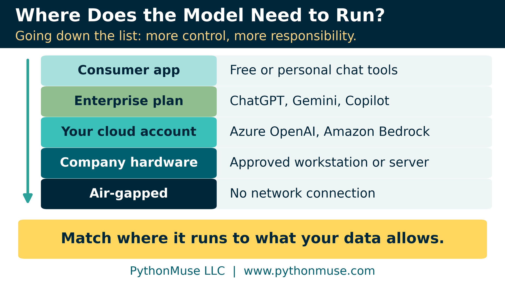
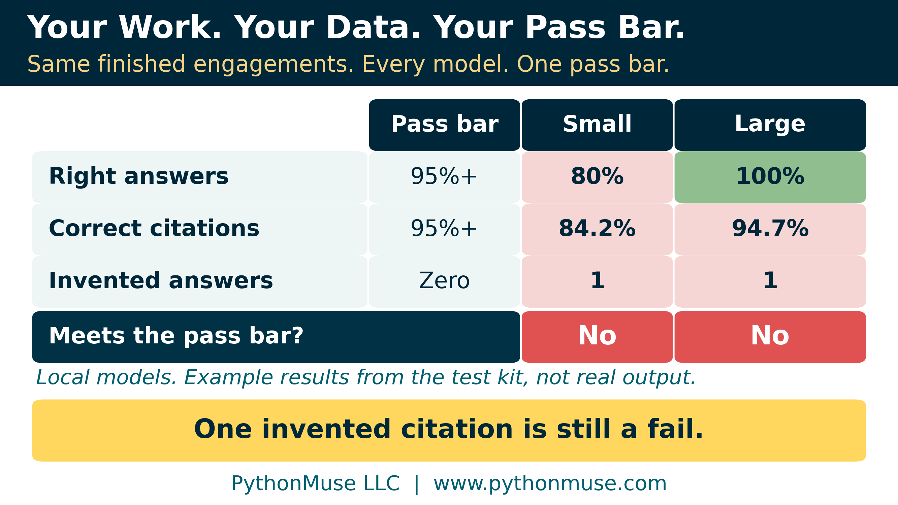
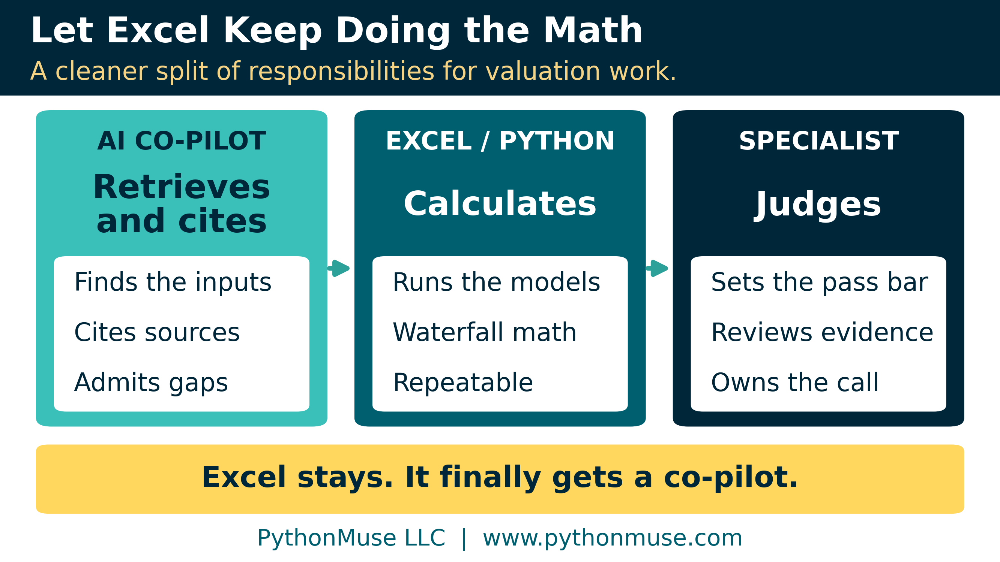
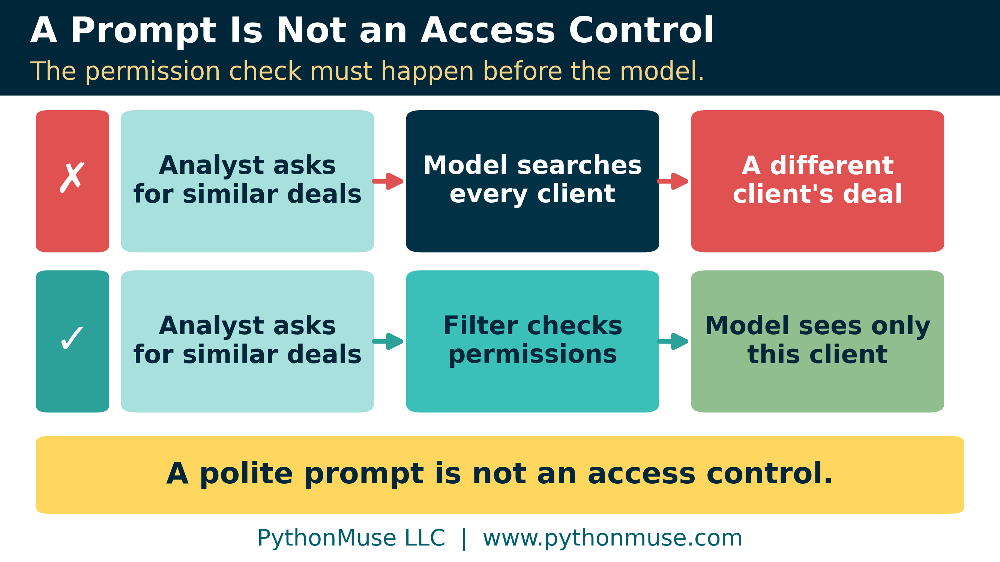

# If the Data Can't Leave, Bring the Model In

*Exploring local LLMs for valuation, M&A, and other confidential financial work*

---

**PythonMuse LLC**
*Published October 2026*

---

I recently had lunch with a valuation specialist. Think M&A transactions, securities and debt valuations, private-company financials, cap tables, and plenty of information that definitely should not accidentally find its way onto the internet. When our conversation turned to AI, it ended fairly quickly. The work is too confidential, and Excel is still where much of it happens.

That is a perfectly reasonable concern. In valuation work, confidentiality is not a nice-to-have control. It is part of the product. But on the drive home, I kept wondering whether it should have been the end of the AI conversation or the beginning of a different one. Every hour a specialist spends locating, comparing, and reformatting information is an hour not spent doing what they were hired to do: analyze.

That is the tension: the data may be too valuable to expose, but the specialist's time is also too valuable to waste.

Maybe the question is not, "Can we use AI?" Maybe the better question is, "Where does the AI need to run?"

Local does not necessarily mean installing an AI model on every employee's laptop. It means running the model in an environment the company controls: perhaps a dedicated workstation, an internal server, a private data center, or another isolated environment. Employees can still use it through a normal browser or internal application, because the model can run centrally for many people. The trade-off is that local means more control and more responsibility. Someone has to manage the infrastructure, access, updates, and testing.

> **📎 Quick definition: what "local" means.** A **large language model (LLM)** is the engine behind tools like ChatGPT, Claude, Gemini, and Copilot. Usually it runs on the provider's servers and you reach it over the internet. A **local model** runs on hardware your company controls instead, and most are **open-weight**: the model file is published so anyone can download and run it, under its own license.

And local is not the only secure option. Enterprise AI platforms can provide contractual, privacy, retention, and security protections that may be entirely appropriate. What matters is what your contracts, customers, [data classification](../06-safe-ai-data-workflows/README.md), and risk tolerance permit. That's the territory of [Your AI Workflow Was Approved. Did Anyone Read the Customer Contract?](../38-ai-workflow-customer-contract/README.md).

If an approved enterprise platform meets those requirements, great. If it does not, that does not automatically mean "no AI." It may simply mean the architecture needs to change.

> **🛠️ Reminder — this is a framework.** The worked examples in this series were built with the Claude extension in Visual Studio Code, because that is what our environment uses. Nothing in the method depends on that choice, and in this article, *where the model runs* is the whole point: a desktop app on an approved machine, a server your company runs, your own cloud account, or an enterprise subscription. The test is the same everywhere. This series teaches the framework, not the vendor.

---

## Start With the Work, Not the Model

This is where I think many AI conversations go backward.

We start with: *"What model should we buy?"*

Instead, start with: *"What work are our people spending time on that AI may be able to help with?"*

For a valuation firm, I would not begin by asking AI to perform a valuation. There are plenty of lower-risk opportunities first.

Consider the information surrounding a transaction or security valuation: financing agreements, debt documents, cap tables, term sheets, financial statements, historical workpapers, prior valuations, customer correspondence, and supporting market data.

An AI system could help identify what documents arrived and what is missing. It could extract agreed-upon terms. It could compare this quarter's materials with the prior quarter and identify what changed. It could find the source supporting an assumption. It could flag inconsistencies between a cap table and a transaction document.

It could also help an analyst locate similar historical work without spending twenty minutes opening folders named things like "FINAL," "FINAL2," and my personal favorite, "FINAL_USE_THIS_ONE."

None of this requires AI to replace valuation judgment. It requires AI to reduce the time professionals spend hunting for information.

> **Under the hood:** New to deal vocabulary? Term sheets, cap tables, liquidation preferences, and waterfalls are explained in one breath in [the technical appendix](./technical-appendix.md#1-valuation-terms-in-one-breath).

This is not purely theoretical. IBM's [case study of Bay Point Advisors](https://www.ibm.com/case-studies/bay-point), an investment firm focused on private debt, describes a platform that lets clients ask questions of secure data rooms in plain language and get answers with citations back to the documents. Bay Point built it on a hosted enterprise model rather than a local one, which fits the point. The architecture has to match what the data allows, and AI is already reducing manual work around confidential private-market information.

---

## Start With What You Did, Not What You Will Do

Start with work you already completed successfully. Pick one narrow task from a prior engagement, such as a financing agreement from last year's closed transaction that a person processed by hand. Give it to the best model you are permitted to run, and compare the output with what the valuation professional actually produced.

You do not need a server for this first check. A small model on an approved laptop is enough to learn whether the idea has legs.

Most importantly, define "acceptable" before testing starts. The output may never match the manual work exactly, so the valuation specialist, not the person adjusting the prompts, sets the pass bar. And don't grade the model on the same engagements you used to tune it. You don't test a control with the sample you used to design it.

> **Under the hood:** Which laptop, which model size, which licenses to read, how many engagements to use, and what to do when the local model falls short are all in [the technical appendix](./technical-appendix.md#2-running-your-first-local-test).

> **Try it Monday:** Pick one closed engagement and one task. Give your co-pilot only the documents that engagement was authorized to use, and this prompt:
>
> *"Using only these documents, identify the liquidation preference, the conversion terms, and the valuation date. For each one, name the document and section it came from. If a value is not stated, answer 'insufficient evidence' instead of estimating. Do not calculate anything."*
>
> Then put the answers next to what your specialist actually concluded. The co-pilot retrieves; the specialist decides whether that was good enough.

---

## Your Work. Your Data. Your Acceptance Criteria.

What you are really building is your own small exam: the same finished engagements, run through every model you're considering, graded against a pass bar set in advance.

Then compare what actually matters:

- **Did it get the answer right?**
- **Did it cite the correct source?**
- **Did it invent anything?**
- **How often did an analyst have to correct it?**
- **How much time did it save?**
- **What did it cost to run?**

Those numbers matter far more than whether somebody on the internet ranked Model A three points above Model B.

> **Run it for real:** The [Local LLM Test Kit](https://github.com/PythonMuse/pythonmuse-local-llm-test-kit) lets you practice on fictional, deliberately booby-trapped deals before you touch your own. One of its example models gets every answer right and still fails. What's in the kit, and how to build the same test from your own engagements, is in [the technical appendix](./technical-appendix.md#3-building-your-own-benchmark).

---

## Why a Smaller Model Might Be Enough

This is where the use case becomes interesting.

A local model may know less about the entire world than the strongest hosted model. But perhaps it does not need to know the entire world.

If you are asking it:

*"Using only these seven authorized documents, identify the liquidation preference, conversion terms, valuation date, and outstanding shares, and show me where each answer came from,"*

then the most important information is already sitting inside the engagement folder.

Likewise, if the model is weaker at complex arithmetic, that matters much less if Excel or Python performs the calculation.

If it cannot hold an entire deal room in its head at once, that matters less if the system looks up only the documents relevant to the question and hands it those.

If it occasionally tries to make things up, require citations and explicitly allow it to respond:

*"I do not have enough evidence to answer this."*

In other words, instead of asking whether a smaller local model can compete with the smartest AI system on earth, ask whether it can reliably perform your defined workflow.

You do not need an AI that can debate philosophy, write a screenplay, and explain quantum mechanics if its actual job is to find the liquidation preference in seven documents.

Those are two very different tests.

> **Under the hood:** The look-it-up-first design (called retrieval, or RAG), the model's working memory (its context window), and why citations are the defense against made-up answers are explained in [the technical appendix](./technical-appendix.md#4-retrieval-context-windows-and-hallucination).

---

## Let Excel Keep Doing What Excel Is Good At

There is another distinction I would make early in any valuation AI project.

Do not turn the LLM into the calculator simply because it can talk confidently about finance.

If the workflow requires a DCF, a Black-Scholes model, a distribution waterfall, a discount rate calculation, or another repeatable valuation model, keep those calculations in validated tools such as Excel or Python. Those tools give the same answer every time for the same inputs. A model's answer can vary from run to run, which is exactly why [When the Invoice Starts Giving Orders](../37-when-the-invoice-gives-orders/README.md) keeps the two apart. If Python still sounds like a different department, [What the Heck Is a Script?](../25-what-the-heck-is-a-script/README.md) is the gentle introduction, and [The Workings Layer](../22-workings-layer-method/README.md) shows how it sits alongside the Excel files you can't change.

Let the AI help retrieve the inputs. Let validated code perform the calculation. Let AI help organize or explain the results. Then let the valuation specialist make the judgment and approve the conclusion.

That is a much cleaner division of responsibilities. AI handles language, retrieval, and organization. Validated tools handle the math. The valuation specialist handles judgment.

Excel does not need to be fired. It just may finally get a co-pilot.

---

## Local Does Not Mean Secure

This part cannot be skipped.

Putting a model on a server inside your building does not sprinkle cybersecurity fairy dust over it. You still need the usual controls: who can log in, what they can see, what gets logged, which model version is approved. A document can still contain instructions a local model will happily follow.

For valuation firms, I think one of the most important risks may actually be far less exciting than anything appearing in cybersecurity headlines: **cross-client retrieval**.

Imagine years of completed deals sitting in one AI knowledge base. An analyst asks:

*"Have we valued another security with terms like this?"*

The AI finds a beautiful example.

Unfortunately, it belongs to another confidential client engagement.

The model did exactly what you asked. The system still failed.

Professional firms already have a name for the control that should have stopped it: an **ethical wall**, or information barrier, the arrangement that keeps one client's confidential information away from people who shouldn't see it. In an AI system, that wall has to be enforced *before* the model receives anything. Once a document is in front of the model, it is too late to ask nicely.

A prompt saying "Please respect customer confidentiality" is not an access control.

If that worked, we could probably replace half of cybersecurity with very polite Post-it notes.

> **Under the hood:** The full local security checklist, model-version control, prompt injection, and how to enforce the ethical wall at the retrieval step are in [the technical appendix](./technical-appendix.md#5-the-local-security-checklist).

---

## ONBOARD It

Local AI does not require a new philosophy of AI governance. The same [ONBOARD checklist](../35-onboard-ai-workflows/README.md) I use for every other AI workflow applies: one narrow task, the authorized documents and nothing else, a plan and pass bar approved before the first run, and a written record of the model version you approved.

Running a model locally gives you more control. It also gives you more responsibility. That trade-off needs to be intentional.

> **Under the hood:** ONBOARD applied letter by letter to a local model is in [the technical appendix](./technical-appendix.md#6-onboard-applied-to-a-local-model).

---

## Maybe the Conversation Should Not Have Ended

I understand why the AI conversation at lunch initially ended when confidential data came up.

That instinct is healthy. Protect the client first.

What I am questioning is what comes immediately after that.

Sensitive information may mean a consumer AI product is inappropriate. It may mean a particular hosted AI service is inappropriate. It may mean a customer contract requires the data to stay somewhere very specific.

But it does not automatically mean AI is inappropriate.

And it definitely does not mean Excel needs to carry the entire workload alone for another twenty years.

Local models have limitations. They may be less capable than the strongest hosted systems. They require engineering and maintenance. Hardware costs money. Someone has to manage them. And local should never be confused with secure.

Those are reasons to evaluate the technology carefully. They are not necessarily reasons to stop the conversation.

For organizations whose most valuable information cannot, or should not, travel freely to an outside AI platform, perhaps the better question is the one I left lunch thinking about:

**If the data cannot leave, what happens when we bring the model in?**

---

Every product, license, and case-study claim in this article was checked against the provider's own documentation in October 2026. The full, dated list is in [the technical appendix](./technical-appendix.md#sources).

---

**A note on how this article was made.** This article started with me. The lunch conversation with a valuation specialist, and the question I kept turning over on the drive home, are mine. This article was written in collaboration with Patrick Toohey. ChatGPT (Sol 5.6 High) helped us shape our notes into a first structured draft. Claude Sonnet and Claude Opus reviewed that draft and co-designed the practice test kit this article points to. Claude Code (Claude Opus 5.5) then built the final article and its technical appendix, the visuals, the test kit's runner and tests, and the site wiring, working from my direction and feedback at each step. That review is where the ONBOARD section was corrected to match the seven steps from Article 35. It is also where every product, license, and case-study claim was checked against the vendor's own documentation. I reviewed every output, pushed back on things I didn't like, and made all final content decisions. That process — bringing your own experience, using AI to build and iterate, and staying in the editorial seat throughout — is exactly what this series is about.

---

*Related: [How to Use AI in Accounting Without Sending the Wrong Data](../06-safe-ai-data-workflows/README.md) | [Don't Just Prompt AI. ONBOARD It.](../35-onboard-ai-workflows/README.md) | [Model Selection Is an Accounting Control](../36-model-selection-is-a-control/README.md) | [Your AI Workflow Was Approved. Did Anyone Read the Customer Contract?](../38-ai-workflow-customer-contract/README.md) | [Buy the Platform. Own the Accounting Logic.](../39-buy-platform-own-accounting-logic/README.md) | [Technical Appendix](./technical-appendix.md)*

*© 2026 PythonMuse LLC. Content licensed under [CC BY-NC-SA 4.0](../../LICENSE); code licensed under [MIT](../../LICENSE-CODE).*
