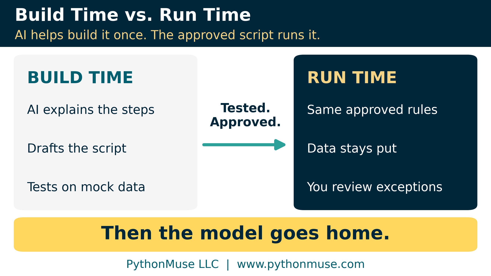
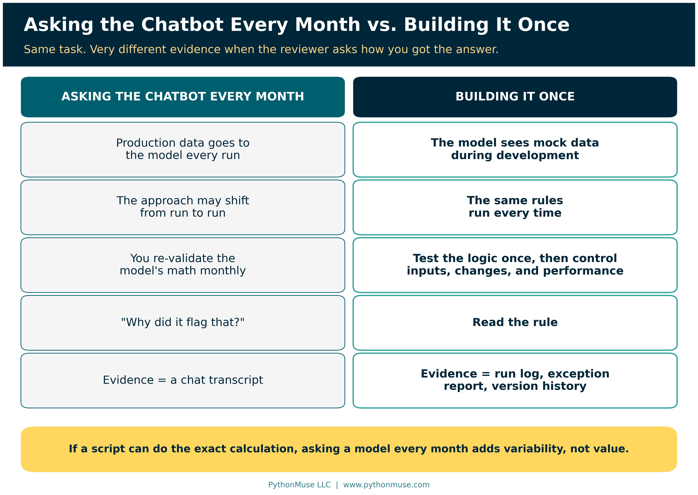
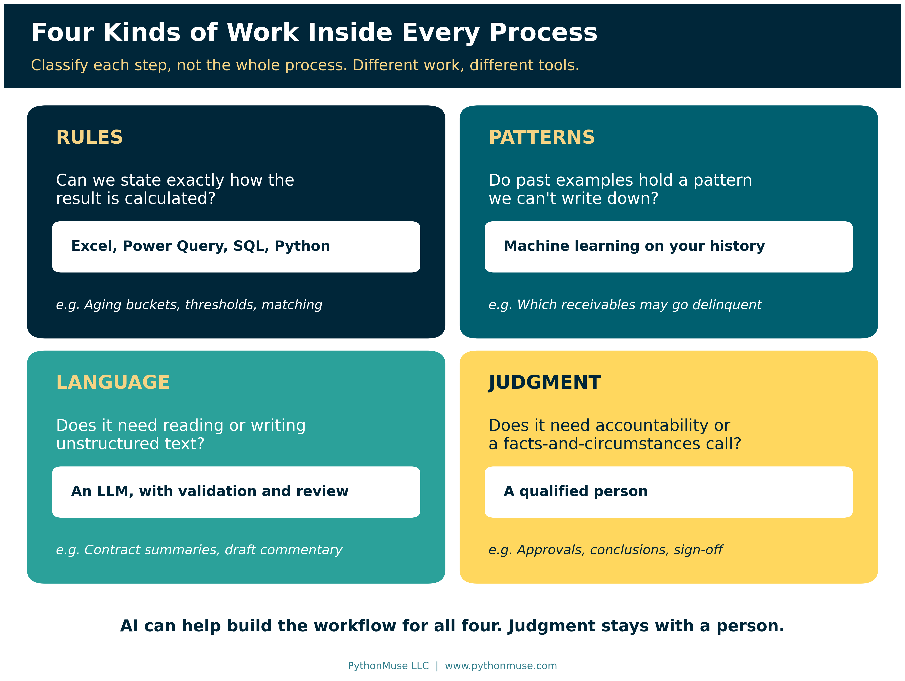
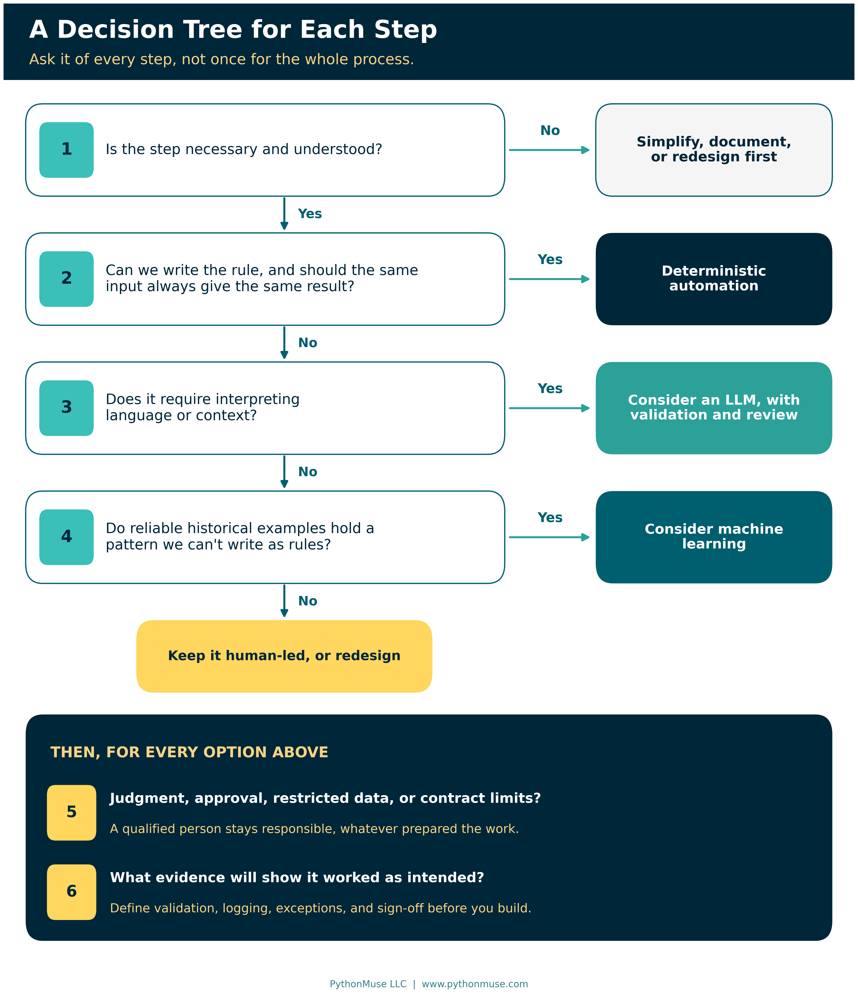
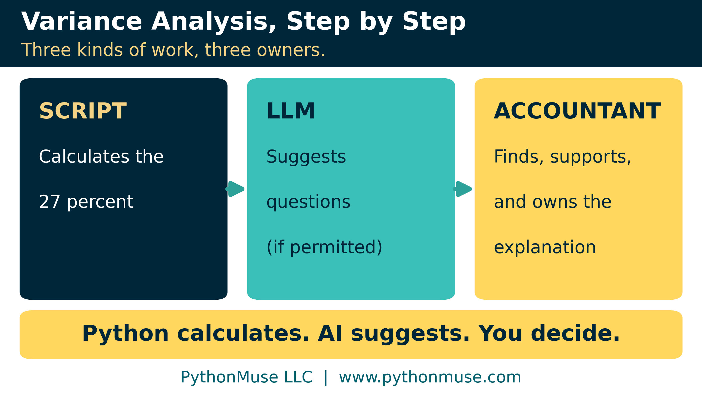

# AI Helped Me Build It. AI Does Not Have to Run It.

*What one year of daily AI use taught me about deterministic automation, and where AI belongs in accounting*

---

**PythonMuse LLC**
*Published October 2026*

---

## One Year, Every Day

It has been almost exactly one year since I made it my mission to use artificial intelligence (AI) in my work every day.

Not occasionally, and not only when an email needed polishing or a blank page needed a little push to get started.

I wanted to know what AI in accounting looks like after the novelty wears off and the work still has to be accurate, repeatable, explainable, and ready for review. So I tested tools, built workflows, led study groups, talked with countless accounting and finance professionals, gave presentations, and published more than 40 articles.

Every time something appeared to work, I tried to ask the second-level question:

> **What is the system actually doing, and would I trust it to do this again next month?**

One misconception followed me the entire year. For many accountants, "using AI" still means uploading a spreadsheet into a chat window and asking the model to analyze it.

That is understandable. A chat window is the most visible place to begin, and it is useful for exploration. But recurring accounting work has to meet a different standard, and the concerns are real: data privacy, hallucinations, and re-checking everything the model says.

Uploading a file and asking questions is where experimentation begins. It should not be where accounting's use of AI ends.

There is a middle ground. It has a name, and I didn't know it when I started.

**Deterministic.**

I arrived at the idea through practice before I learned the word. I didn't want AI to analyze the same accounting data from scratch every month.

I wanted AI to help me build the process that does the analysis.

---

## The False Choice

Accountants keep getting offered two options:

1. Upload financial data to an AI model and accept the privacy and reliability concerns.
2. Or avoid AI and miss the efficiency.

Deterministic automation is option three.

AI can help an accountant translate an existing procedure into an Excel formula, a Power Query transformation, a Structured Query Language (SQL) query, or a Python script. It can explain unfamiliar code, suggest tests, spot edge cases, and draft documentation. Once the automation is tested and approved, the recurring process runs on defined logic.

**AI helped build it. AI does not have to run it.**

| Asking the chatbot every month | Building it once |
|---|---|
| Production data goes to the model every run | The model sees mock data during development |
| The approach may shift from run to run | The same rules run every time |
| You re-validate the model's math monthly | You test the logic before release, then control inputs, changes, and ongoing performance |
| "Why did it flag that?" | Read the rule |
| Evidence = a chat transcript | Evidence = run log, exception report, version history |

Why is this important in accounting? In our work, we rely on consistent calculations, complete populations, defined source files, and proof that a process ran as intended. We also handle payroll, customer information, bank activity, and acquisition data. None of it belongs in an unapproved chat window simply because that happens to be the most convenient place to work.

If a script can perform an exact calculation reliably, asking a generative model to recreate it every month adds variability without adding value. The real payoff is better use of an accountant's time: exceptions, explanations, and decisions, instead of checking, again, whether the system added the same columns correctly.

---

## Think of It Like Excel

Imagine telling Excel: *"Go format this data the way I need it. I'll be at lunch."*

For years, that was a fantasy. Now, with Copilot in Excel, you sort of can. Describe what you want in plain English, and it can help clean up the data, highlight, sort, and filter it, and add formula columns for you.

That is useful. But next month you ask again. And Copilot works it out again. And you check it again.

Excel has quietly offered the other option for years: Power Query. You record the cleanup steps once. Next month you drop in the new file and click Refresh. Same steps. Same order. Same result. Nobody re-interprets anything.

| Ask Copilot every month | Build it once in Power Query |
|---|---|
| Describe the cleanup each time | Record the steps once |
| AI works out the approach each run | The recorded steps replay |
| You re-check the output monthly | Test the recorded steps, then monitor source changes and outputs |
| Great for one-off requests | Built for recurring work |

That is the whole idea of this article, in a tool you already own.

---

## What "Deterministic" Means in Plain English

"Deterministic" sounds more technical than it is. Accountants have used deterministic processes for decades.

**Same inputs + same rules (in the same environment) = same outputs.** That's it.

An aging calculation is deterministic. A SUM formula is deterministic. A rule that sends every transaction over $25,000 for extra approval is deterministic. The system does not wake up on Tuesday and decide that $24,750 feels suspicious.

A large language model (LLM) works differently. It generates a response based on probabilities. Give it substantially the same instructions and data twice, and the wording, reasoning, classification, or conclusion may change.

That flexibility is why LLMs are good at interpreting language and messy requests. It is also why their output needs validation. Neither approach is universally better; they are built for different kinds of work.

> **Under the hood:** Library versions, hidden inputs like Excel's `TODAY()`, SQL's `ORDER BY`, and why you can't simply switch an AI model into "always give the same answer" mode are in [the technical appendix](./technical-appendix.md#2-why-same-rules-isnt-quite-enough).

So the question is not *"Can we use AI for this process?"* The better question is: **what kind of work happens inside each step of this process?**

---

## AI Can Build the Workflow Without Living Inside It

Take duplicate-payment testing.

**Option one:** upload the accounts payable (AP) data to an LLM every month and ask, "Which of these look like duplicates?" The model might find useful items. It might also read the request differently next month, skip a relevant record, or confidently flag two payments that merely look alike.

**Option two:** ask AI to help build a Python script that applies the criteria the accounting team approved (same vendor, same invoice, same amount, paid within 30 days) and hands every match to an accountant. The script doesn't decide anything is a duplicate. It finds what meets the rule, the same way, every time.

During development, AI might write the code, explain each line, generate mock data, and suggest test cases. When the test runs next month, production data does not need to go anywhere near the model.

Then the model goes home.

The script keeps working.

This is the difference between **build-time AI** and **run-time AI**. At build time, AI assists the person designing the workflow. At run time, the approved process does the work. AI can still have a run-time role, but that should be a design decision, not a default.

We built that script for this article as a small working demo: a handful of made-up payments, seeded with the tricky cases we could think of, plus the answer the script should produce. One pair it misses on purpose. Hold that thought.

We also put the build step itself to the test. Same prompt, same model, two fresh sessions, each asked to write this script. We got two different scripts and two different answers: one reported two possible duplicates, the other one. The first turned two payments with blank invoice numbers into a "duplicate" of each other. The second quietly dropped them from testing and never said so. Both looked perfectly reasonable. That is fine at build time, because you test one version against a known answer, fix it, and freeze it. It is not fine if every month is a fresh session.

> **Under the hood:** The code line by line, the two-session experiment side by side, the bug AI helped us write into our own first draft (and the test that caught it), and how to run the demo yourself are in [the technical appendix](./technical-appendix.md#1-the-duplicate-payment-script-line-by-line). New to scripts? [What the Heck Is a Script?](../25-what-the-heck-is-a-script/README.md) is the gentle on-ramp.

---

## Classify Each Step, Not the Whole Process

Technology decisions get confusing when we label an entire process an "AI use case."

A bank reconciliation, a variance analysis, or a journal-entry process is rarely one kind of work. It might contain a calculation, a matching exercise, some language interpretation, an investigation, and an approval. Those pieces should not automatically use the same technology.

So break the process into steps, and classify the work inside each one. Four categories are a good start: **rules, patterns, language, and judgment.**

- **Rules:** *Can we state exactly how the result is calculated?* Aging buckets, allocations, matching criteria, thresholds. Deterministic automation follows the rules; AI can help build it. (The same idea runs through [Don't Trust the Model to Find What You Already Know Is There](../23-schema-driven-sanitization/README.md).)
- **Patterns:** *Do past examples hold a relationship we can't write down?* That may be machine learning, such as estimating which receivables are likely to go delinquent. The difference from a rule is where the logic came from: a person wrote it, or the data taught it. Machine learning deserves its own article.
- **Language:** *Does the work require interpreting or producing unstructured text?* This is where an LLM earns its keep: contract summaries, draft variance commentary. The flexibility is the feature, and the reason for validation. [From AI Answers to Audit Trails](../32-from-ai-answers-to-audit-trails/README.md) covers what that looks like. An LLM is one kind of **decision model**: the method a step uses to reach its result. A written rule, a model trained on your history, and a qualified person are the others. Choosing the right one for each step gets its own article soon.
- **Judgment:** *Does it need professional accountability or a facts-and-circumstances call?* That stays with a qualified person. AI should not quietly inherit approval authority because it helped automate the steps leading up to the decision.

Before any of that, ask whether the step is still necessary. Automating a process nobody understands is just an efficient way to produce confusion on schedule.

Whatever you choose for a step, a person stays accountable, and you define the evidence that it worked before you build it.

> **Framework reminder:** None of this depends on a particular tool. The same questions work whether the deterministic part ends up as an Excel formula, a Power Query, a SQL view, or a Python script, and whether the co-pilot helping you build it is Claude Code, OpenAI Codex, GitHub Copilot, or Copilot in Excel. The tool changes; the classification does not.

> **Under the hood:** The full decision tree, all six questions, is in [the technical appendix](./technical-appendix.md#3-the-decision-tree-question-by-question), and there is a printable [Step Decision Tree card](./templates/step_decision_tree_card.md) for the desk.

### What it looks like in a real workflow

Take year-over-year variance analysis. It's tempting to call the whole thing an AI use case. Break it into steps and a better design appears.

The script checks the files, calculates the changes, and applies the materiality thresholds. An LLM, if permitted, can help draft questions for the account owner. But the model should not invent the reason travel expense went up 27 percent.

**Python calculates the 27 percent. AI suggests questions. The accountant finds, supports, and owns the explanation.**

The process is neither "AI-driven" nor "deterministic." It is a controlled workflow containing different kinds of work. (The step-by-step breakdown is in [the technical appendix](./technical-appendix.md#4-a-real-workflow-step-by-step).)

---

## Deterministic Does Not Mean Correct

Deterministic automation has real control advantages. The logic can be inspected, tested against known answers, version-controlled, and approved. Run logs show what was processed and what came out.

Deterministic does not mean correct.

**A script can apply the wrong rule perfectly. Every month. Forever.**

Remember the pair our duplicate-payment demo misses on purpose? "ABC Corp" and "ABC Corporation," same invoice number, same $2,100.00, paid a week apart. A person would spot it in a second. The script compares exact vendor keys, "ABCCORP" is not "ABCCORPORATION," and so it misses the pair. Consistently. Every run.

The rule isn't broken. It is exactly what was approved. It is just incomplete, and the script's consistency makes that invisible until someone tests for it. The same goes for an incomplete file, last year's threshold, or a library update nobody noticed.

Consistency makes the process testable. It does not make testing optional.

That is why organization, boundaries, and validation stay central:

- **Organization:** know what the process is supposed to do.
- **Boundaries:** limit the data, tools, outputs, and actions the workflow can touch. And know which boundaries are real: "do not touch the payroll folder" written in an AI agent's instructions is a polite request; a permission setting the tool enforces is a control. ([The technical appendix](./technical-appendix.md#5-scripts-skills-agents-and-the-controls-around-them) shows the difference.)
- **Validation:** check results against known examples, control totals, expected ranges, and documented exceptions.

Treat changes to the logic with the same seriousness as changes to an important spreadsheet or a financial system configuration. Because that is what they are. ([Pull Requests Are Internal Controls](../20e-pull-requests-are-controls/README.md) shows that review for code, and [Model Selection Is an Accounting Control](../36-model-selection-is-a-control/README.md) is the same lesson for the LLM steps.)

---

## The Rule of Thumb

- **If the rule is known,** encode the rule. (Don't know how? Ask your AI co-pilot to help you build it. That's the whole point.)
- **If language must be interpreted,** consider an LLM, and validate it.
- **If historical examples hold a pattern you can't write down,** machine learning may fit.
- **If the decision needs professional accountability,** keep a person responsible.

---

## Try This Week

Pick one recurring process, but not the hardest one in the department. Month-end close does not need to be your first science project. Pick something narrow, repetitive, and familiar: a variance calculation, a duplicate-payment test, a missing-field check, a reconciliation prep step.

1. Write down each step in order.
2. For each step, note the input, expected output, rule, possible failure, reviewer, and evidence kept.
3. Classify it: rule, pattern, language, or judgment.
4. Then ask AI to help you *examine* the process, not automate it. Where are the rules clear? Where is undocumented judgment hiding? Where must a person stay responsible?

You may find that a "manual" process already contains several automatable pieces.

You may also find that your "AI workflow" doesn't need AI in every step.

> **Use the worksheet:** Download the [Process Step Classification Worksheet](./templates/process_step_classification_worksheet.xlsx) (also available as [CSV](./templates/process_step_classification_worksheet.csv)) and map one process step by step. It comes pre-filled with the variance-analysis example above.

> **Take it with you:** Beyond the worksheet, this article's folder has a desk card for the decision tree, a build-time vs. run-time record, a release checklist for scripts, a "control or polite request?" boundary audit, and the runnable duplicate-payment demo. All synthetic, all meant to be copied. The full list is in [the technical appendix](./technical-appendix.md#6-the-toolkit).

---

## The Lesson After One Year

At first I thought AI maturity meant asking better questions.

Then I learned the environment mattered as much as the prompt. Moving into a harness (a workspace like Claude Code in Visual Studio Code, where AI works with your files, tools, and saved instructions) gave me a way to organize files, write reusable instructions, set boundaries, use approved tools, keep documentation, and validate outputs.

About 40 articles later, most of what I've learned still fits in three words: **organization, boundaries, and validation.**

Now I'd add a fourth: **placement.**

Where does AI belong in the process?

Sometimes it helps build the automation. Sometimes it interprets language. Sometimes it coordinates approved tools. Sometimes it prepares information for a decision.

And sometimes it steps out of the production workflow entirely.

AI maturity is not putting AI into more decisions. It is being deliberate about which method belongs in each step.

Once the process is broken into rules, patterns, language, and judgment, the next question is: which decision model belongs in each step? That is a question for a future article in this series.

---

## Sources

Every provider-specific statement in this article was checked against the provider's own documentation in October 2026. The full, dated list is in [the technical appendix](./technical-appendix.md#sources).

---

**A note on how this article was made.** This article started with me. The year of daily AI use behind it, and the word I learned only after I had been practicing it for months, are mine. This article was written in collaboration with Patrick Toohey. ChatGPT (5.5 Sol) helped us shape our notes into a first structured draft. Claude Sonnet and Claude Opus reviewed that draft and co-built the practice files this article points to. Claude Code (Claude Opus 5.5) then built the final article and its technical appendix, the visuals, the templates, the tested duplicate-payment demo, the two-session experiment, and the site wiring, working from our direction and feedback at each step. That review is where the bug in the original code snippet was found and fixed, and where every Claude Code, Codex, Copilot, and Excel claim was checked against the provider's own documentation. I reviewed every output, pushed back on things I didn't like, and made all final content decisions together with Patrick. That process — bringing your own experience, using AI to build and iterate, and staying in the editorial seat throughout — is exactly what this series is about.

---

*Related: [From One-Time Analysis to Repeatable Workflows](../11-one-time-to-repeatable-workflows/README.md) | [AI Can't Work With Our Excel Files... or Can It?](../15-ai-and-excel-files/README.md) | [The Power of Skills and Agents](../17-skills-and-agents-for-accountants/README.md) | [Don't Trust the Model to Find What You Already Know Is There](../23-schema-driven-sanitization/README.md) | [What the Heck Is a Script?](../25-what-the-heck-is-a-script/README.md) | [Metadata Is the Label Maker Your AI Workflow Needs](../31-metadata-is-the-label-maker/README.md) | [You Built an AI Workflow. What Happens If You Win the Lottery?](../40-builder-to-production/README.md) | [Technical Appendix](./technical-appendix.md)*

*© 2026 PythonMuse LLC. Content licensed under [CC BY-NC-SA 4.0](../../LICENSE); code licensed under [MIT](../../LICENSE-CODE).*
