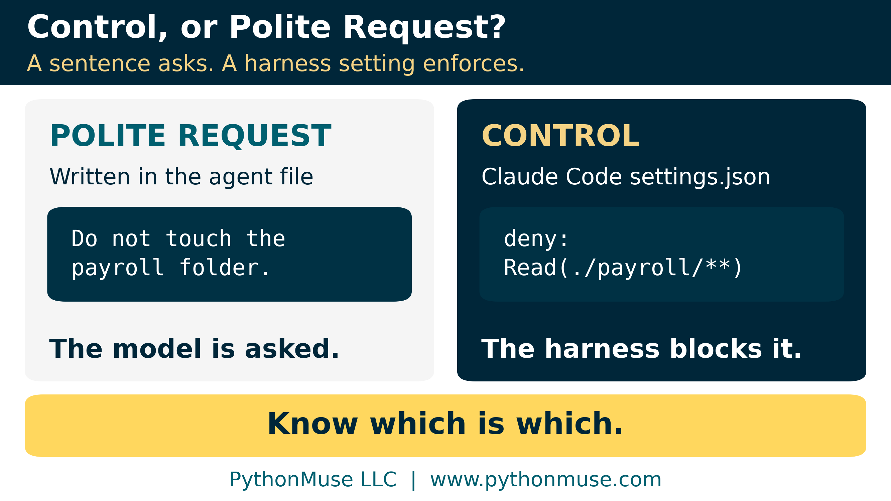

# AI Helped Me Build It: The Technical Appendix

*Under the hood of Article 42: the demo script line by line, the fine print on "deterministic," the full decision tree, a real workflow step by step, and how scripts, skills, agents, and harness controls fit together*

---

**PythonMuse LLC**
*Published October 2026*

---

This page is for readers who want to run the demo, read the code, walk the full decision tree, or wire up the controls. [The article](./README.md) stands on its own; nothing here changes its argument. Think of this as the workpapers behind the memo.

---

## 1. The Duplicate-Payment Script, Line by Line

The article describes a Python script that follows criteria the accounting team approved. In plain English, the script:

- Makes vendor names and invoice numbers comparable, so "INV-1043" and "inv 1043" count as the same invoice.
- Sets aside any payment with a blank vendor or invoice number for a person, instead of guessing.
- Compares amounts in whole cents, so floating-point leftovers can't make equal amounts look different.
- Pairs payments with the same vendor, invoice, and amount, paid within 30 days, and writes them to an exception report.

Notice what the script does not do. It does not decide that anything is a duplicate. It consistently finds transactions that meet the approved criteria and hands them to an accountant.

Here is its core.

> **Simplified illustration, not production-ready code.** It leaves out the schema checks, logging, and run evidence a production script needs. This is the core of [`duplicate_payment_test.py`](./duplicate_payment_test.py), which you can run yourself.

```python
from pathlib import Path

import pandas as pd

DATA = Path(__file__).parent / "data"

# Read IDs as text, so 1043 never becomes "1043.0" and 001043 keeps its zeros
ap = pd.read_csv(DATA / "ap_payments.csv", parse_dates=["payment_date"],
                 dtype={"payment_id": str, "vendor_name": str, "invoice_number": str})

# Standardize so "INV-1043" and "inv 1043" are treated as the same invoice
def match_key(column):
    return column.fillna("").str.upper().str.replace(r"[^A-Z0-9]", "", regex=True)

ap["vendor_key"] = match_key(ap["vendor_name"])
ap["invoice_key"] = match_key(ap["invoice_number"])

# A blank key can't be tested, and pandas would pair blanks with each other.
# Send those rows to a person instead of guessing.
blank = (ap["vendor_key"] == "") | (ap["invoice_key"] == "") | ap["amount"].isna()
missing_keys = ap[blank]
testable = ap[~blank].copy()
testable["amount_cents"] = (testable["amount"] * 100).round().astype(int)  # compare pennies

# Pair payments with the same vendor, invoice, and exact amount
pairs = testable.merge(testable, on=["vendor_key", "invoice_key", "amount_cents"],
                       suffixes=("_a", "_b"))
pairs = pairs[pairs["payment_id_a"] < pairs["payment_id_b"]]

# Apply the date tolerance the accounting team approved
DATE_TOLERANCE_DAYS = 30
pairs["days_apart"] = (pairs["payment_date_b"] - pairs["payment_date_a"]).dt.days.abs()
duplicates = pairs[pairs["days_apart"] <= DATE_TOLERANCE_DAYS]
```

**Translation:**

1. Read invoice numbers as text, so 1043 stays 1043 instead of quietly becoming a decimal.
2. Make vendor names and invoice numbers comparable: uppercase, no punctuation, no spaces.
3. Set aside any payment with a blank vendor or invoice number for a person to review. They can't be tested automatically, and left in, pandas would happily pair every blank with every other blank.
4. Convert amounts to whole cents, so tiny floating-point leftovers from exports or calculations can't make equal amounts look different. (Yes, that is a real problem: in most programming languages, 0.1 + 0.2 does not exactly equal 0.3. Numbers are rarely as clean as they look; see [AI Didn't Break Your Numbers. Excel Did.](../24-excel-number-trap/README.md))
5. Find payments that share a vendor, an invoice number, and an amount.
6. Keep only pairs paid within 30 days of each other.
7. The full script then writes everything to one exception report and counts what was tested.

### The bug we caught

A confession, because it proves the point: the first draft of this snippet, written with AI help, had exactly the kind of bug that disclaimer warns about. If the invoice column held only numbers plus one blank, 1043 became "1043.0", the punctuation strip turned it into "10430", and the two blank-invoice payments were reported as a duplicate of each other. We caught it the boring way: by running the code against seeded test data with a known answer. Which is rather the point of the whole article.

### Run it yourself

The article folder includes the full [`duplicate_payment_test.py`](./duplicate_payment_test.py), a synthetic [`ap_payments.csv`](./data/ap_payments.csv), and a hand-calculated [`expected_exceptions.csv`](./data/expected_exceptions.csv). The sample data is seeded on purpose: "INV-1043" vs. "inv 1043", a blank invoice number, payments 29 days apart (flagged) and 31 days apart (not flagged), and one pair the script deliberately misses ("ABC Corp" vs. "ABC Corporation," the subject of the article's "Deterministic Does Not Mean Correct" section).

Run `python duplicate_payment_test.py` and it checks its own output against the expected answer. The [test file](./test_duplicate_payment_demo.py) pins down every deliberate edge case, including the one the script misses, so nobody "fixes" the lesson out of the sample data.

If you are new to scripts altogether, [What the Heck Is a Script?](../25-what-the-heck-is-a-script/README.md) is the gentle on-ramp.

---

## 2. Why "Same Rules" Isn't Quite Enough

The article's definition is **same inputs + same rules (in the same environment) = same outputs.** Three bits of fine print.

### The environment is part of the input

That small "in the same environment" matters. A script running on a different version of a library is, quietly, a slightly different script. [Python Libraries for Accountants](../28-python-libraries-for-accountants/README.md) explains why each project should have its own environment with the same library versions every time it runs.

### Hidden inputs: `TODAY()` and friends (and a SQL cousin)

`TODAY()` and `NOW()` are deterministic. They just read an input you never typed: the system clock. Build an aging schedule on `TODAY()` and tomorrow it gives a different answer, exactly as designed, because the input moved. That is a hidden input, not randomness, and hidden inputs are what make last month's numbers hard to reproduce. The fix is boring and effective: put the as-of date in a cell, label it, and point every formula at that cell.

`RAND()` is the genuine exception: it is designed to return a different value every time it recalculates. Excel calls all three "volatile," but that word describes *when* they recalculate (every time the workbook does), not whether they are deterministic.

Databases have a cousin of this problem: a SQL query without `ORDER BY` doesn't promise to return rows in the same order twice.

### Temperature zero does not make an LLM deterministic

First, what temperature is. As a large language model writes, it picks each next word (strictly, each next *token*: a word or piece of a word) from a ranked list of likely candidates. **Temperature** is the setting that controls how adventurous that pick is. A low temperature keeps the model near the top of the list; a high one lets it wander further down. Low is the "follow the template" setting; high is the "brainstorm session." You will usually find it in API and developer tool settings, not in chat apps, and not every model accepts it.

So the natural question: turn it to zero, and doesn't the model become deterministic? No. Zero makes the output more consistent, not guaranteed identical. Small differences in how the computation is run, and updates on the provider's side, can still change the answer. The providers say so themselves: Anthropic's API documentation says so in as many words, and OpenAI describes its own reproducibility controls as best effort. (Both are linked in the Sources below.)

---

## 3. The Decision Tree, Question by Question

The article classifies each step as rules, patterns, language, or judgment. Here is the full tree behind that picture. Ask these questions of **each step**, not once for the whole process.

**Choose the starting approach:**

1. **Is the step necessary and understood?** No → simplify, document, or redesign first.
2. **Can we write the rule, and should the same input always give the same result?** Yes → start with deterministic automation.
3. **Does it require interpreting language or context?** Yes → consider an LLM, subject to data restrictions, validation, and review.
4. **Do reliable historical examples hold a pattern we can't write as rules?** Yes → consider machine learning. No → keep it human-led or redesign.

**Then apply two control questions to every option**, whatever you chose:

5. **Does the step involve judgment, approval, restricted data, or contractual limitations?** Yes → a qualified person stays responsible, whatever technology prepared the work.
6. **What evidence will show that it worked as intended?** Define validation, logging, exception handling, and sign-off before you build.

There is a printable one-page version in the templates folder: [Step Decision Tree card](./templates/step_decision_tree_card.md).

---

## 4. A Real Workflow, Step by Step

The article's worked example is year-over-year variance analysis. Here is the full breakdown behind the swimlane picture:

| Process step | Nature of the work | Likely approach |
|---|---|---|
| Confirm expected files and fields are present | Known rules | Deterministic automation |
| Validate reporting periods and control totals | Known rules | Deterministic automation |
| Calculate dollar and percentage changes | Known calculations | Deterministic automation |
| Apply materiality thresholds | Approved policy rules | Deterministic automation |
| Retrieve supporting transaction detail | Defined retrieval | Query, script, or approved tool |
| Draft preliminary commentary | Language and context | LLM, if permitted |
| Determine the actual business explanation | Evidence and judgment | Accountant |
| Approve the final analysis | Accountability | Human reviewer |

Bank reconciliations and recurring journal entries work the same way: the script prepares and separates the exceptions; the accountant investigates and approves. The system does not post an entry just because the math worked.

To map one of your own processes this way, use the [Process Step Classification Worksheet](./templates/process_step_classification_worksheet.xlsx); it comes pre-filled with this example.

---

## 5. Scripts, Skills, Agents, and the Controls Around Them

### Three different roles

As more accountants work in AI harness environments (Claude Code in the terminal or inside Visual Studio Code, OpenAI Codex, or GitHub Copilot's agent mode, where AI works with your files, tools, and saved instructions), one more distinction matters:

- A **script** encodes defined logic, and applies the same rules every time.
- A **skill** gives AI reusable instructions: which files to expect, which approved script to run, when to stop for human review. It makes the model more consistent, not deterministic.
- An **agent file** defines a role and its boundaries: which tools it may use and which decisions need a human. [The Power of Skills and Agents](../17-skills-and-agents-for-accountants/README.md) introduces both.

| Accounting world | Harness world |
|---|---|
| Calculation template | Script |
| Desk procedure / standard operating procedure (SOP) | Skill |
| Role description + delegation of authority | Agent file |
| System access rights | Harness permissions |
| Reviewer sign-off | Still you |

### Control, or polite request?

Here's the part people miss.

*"It says right there in the agent file: do not touch the payroll folder."*

That sentence is an instruction. The model is asked to follow it. A hard boundary is enforced by the harness itself: tool allowlists, permission settings, folder access, sandboxing. Know which of your boundaries are controls and which are polite requests. (If a boundary that only *asks* makes you uneasy, it should: [When the Invoice Starts Giving Orders](../37-when-the-invoice-gives-orders/README.md) shows why.)



<!-- TODO: Add a link to the MCP article here once it is published (planned as Article 41 in the approved plan; check the final number before linking). MCP servers are where "approved tools an agent can call" becomes concrete. -->

### Claude Code

Some fields in an agent file *are* enforced. In Claude Code, a subagent's `tools:` line is an allowlist: the subagent simply doesn't get tools that aren't on it. The sentences are not.

Turning "please don't touch payroll" into a control is a few lines in the project's `.claude/settings.json`:

```json
{
  "permissions": {
    "deny": [
      "Read(./payroll/**)",
      "Edit(./payroll/**)"
    ]
  }
}
```

Deny rules are checked before allow rules, and an allow rule can't carve an exception out of one. One honest caveat, straight from Anthropic's own documentation: these rules govern Claude's file tools and the shell commands Claude Code recognizes, not a Python script that opens the file on its own. For enforcement at the operating-system level, Claude Code has a sandbox. Controls have a scope. Know it.

### Other harnesses, same idea

> **A note on tools:** I build in Claude Code inside Visual Studio Code, because that is what our environment uses. Other harnesses have the same idea under different names. In **OpenAI Codex**, the `sandbox_mode` setting (`read-only`, `workspace-write`, or `danger-full-access`) is enforced by the operating system, and `approval_policy` decides when Codex must stop and ask. In **GitHub Copilot's agent mode in VS Code**, you choose which tools the agent can use from the tools picker, and tool calls and terminal commands wait for your approval unless you have auto-approved them (agent sandboxing there is still in preview). If your organization has no harness at all, the Excel version of this lesson is folder permissions and workbook protection rather than a "please don't edit" note on the tab: the control lives in the system, not in the instructions.

Settings like these change often, so check your provider's current documentation before you rely on one. To inventory your own boundaries, use the ["Control or Polite Request?" Boundary Audit](./templates/boundary_audit.md).

---

## 6. The Toolkit

Everything below lives in the article's folder. All of it uses synthetic data, and all of it is meant to be copied and adapted:

- **[Process Step Classification Worksheet](./templates/process_step_classification_worksheet.xlsx)** ([CSV](./templates/process_step_classification_worksheet.csv)): map each step's input, output, rule, failure mode, reviewer, evidence, and classification.
- **[Step Decision Tree card](./templates/step_decision_tree_card.md):** the six questions on one page, for the desk.
- **[Build-Time vs. Run-Time AI Record](./templates/build_time_vs_run_time_record.md):** for one workflow, what AI did while you built it, what data it saw, whether it has a run-time role, and who approved that choice.
- **[Deterministic Script Release Checklist](./templates/deterministic_script_release_checklist.md):** known-input tests, control totals, schema checks, pinned versions, a fixed as-of date, run logs, and sign-off before a script goes live.
- **["Control or Polite Request?" Boundary Audit](./templates/boundary_audit.md):** list every boundary in your skill and agent files and mark which ones the harness actually enforces.
- **[Duplicate-payment demo](./duplicate_payment_test.py):** the script above, its [synthetic data](./data/ap_payments.csv), the [expected result](./data/expected_exceptions.csv), and a [test file](./test_duplicate_payment_demo.py) that pins down every deliberate edge case, including the one it misses.

---

## Sources

Every provider-specific statement in Article 42 and this appendix was checked against the provider's own documentation in October 2026:

- Anthropic: [Messages API reference](https://platform.claude.com/docs/en/api/messages) (temperature: "even with `temperature` of `0.0`, the results will not be fully deterministic")
- OpenAI: [Advanced usage: reproducible outputs](https://developers.openai.com/api/docs/guides/advanced-usage) (determinism is not guaranteed)
- Anthropic: [Claude Code permissions](https://code.claude.com/docs/en/permissions) (deny rules, their scope, and the sandbox) and [Claude Code subagents](https://code.claude.com/docs/en/sub-agents) (the `tools` allowlist)
- OpenAI: [Codex agent approvals and security](https://learn.chatgpt.com/codex/agent-approvals-security) (sandbox modes and approval policies)
- Microsoft: [VS Code agent approvals and permissions](https://code.visualstudio.com/docs/agents/run/approvals) and [VS Code agent tools](https://code.visualstudio.com/docs/copilot/agents/agent-tools)
- Microsoft: [Get started with Copilot in Excel](https://support.microsoft.com/en-us/copilot-excel) and [Clean up your data with Copilot in Excel](https://support.microsoft.com/en-us/excel/copilot/clean-up-your-data-with-copilot-in-excel)
- Microsoft: [Excel recalculation and volatile functions](https://learn.microsoft.com/en-us/office/client-developer/excel/excel-recalculation) and [ORDER BY clause (Transact-SQL)](https://learn.microsoft.com/en-us/sql/t-sql/queries/select-order-by-clause-transact-sql)
- pandas: [`DataFrame.merge`](https://pandas.pydata.org/docs/reference/api/pandas.DataFrame.merge.html) ("If both key columns contain rows where the key is a null value, those rows will be matched against each other.")

Harness settings and product features change quickly. Re-check them before you rely on one.

---

*Back to the article: [AI Helped Me Build It. AI Does Not Have to Run It.](./README.md)*

*Related: [Python Libraries for Accountants](../28-python-libraries-for-accountants/README.md) | [Metadata Is the Label Maker Your AI Workflow Needs](../31-metadata-is-the-label-maker/README.md) | [When the Invoice Starts Giving Orders](../37-when-the-invoice-gives-orders/README.md)*

*© 2026 PythonMuse LLC. Content licensed under [CC BY-NC-SA 4.0](../../LICENSE); code licensed under [MIT](../../LICENSE-CODE).*
