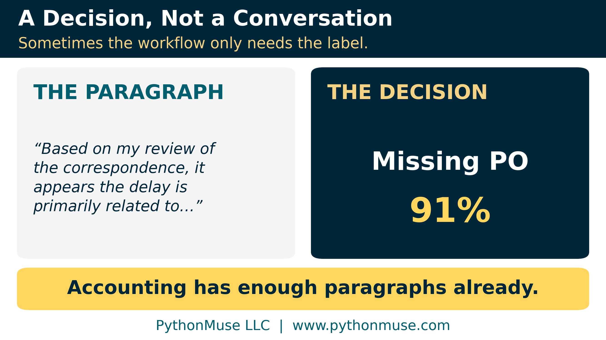
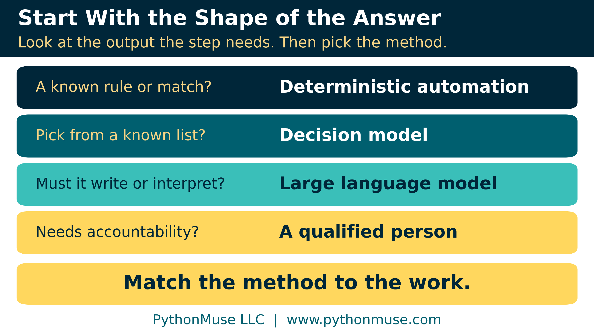
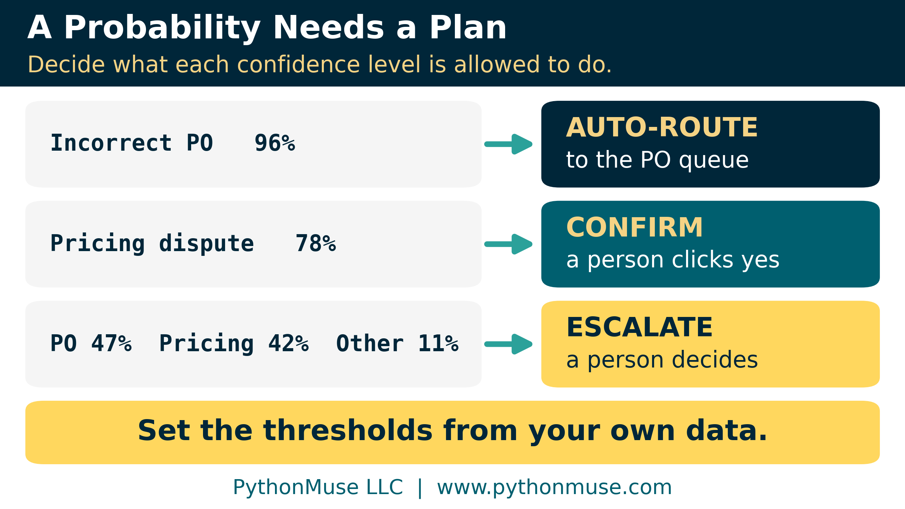
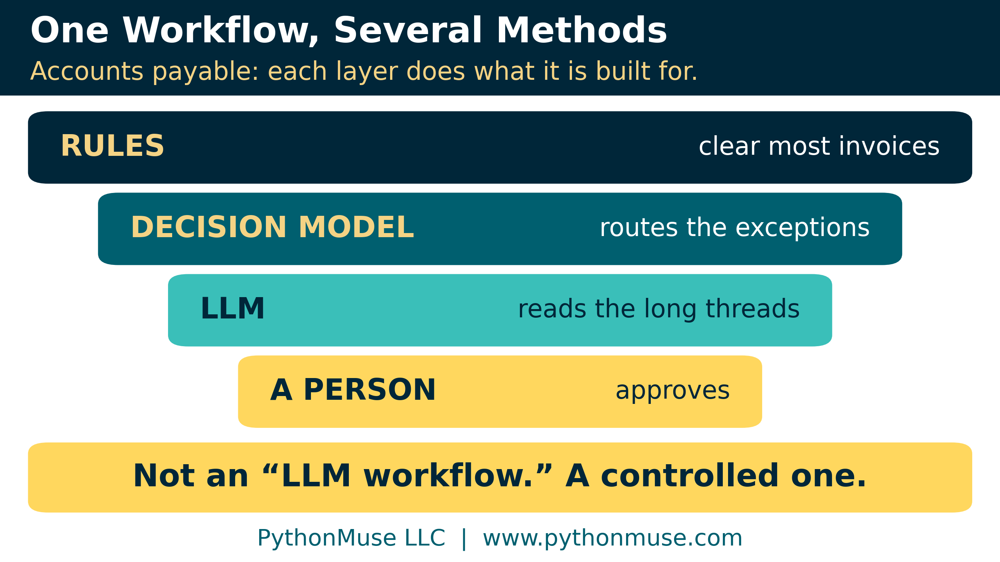

# Does This Decision Actually Need a Large Language Model?

*When accounting needs a choice, score, or probability instead of another paragraph*

---

**PythonMuse LLC**
*Published October 2026*

---

## A Decision, Not a Conversation

For two articles I have been removing assumptions from the artificial intelligence (AI) conversation. [If the Data Can't Leave, Bring the Model In](../41-bring-the-model-in/README.md) asked where the model should run. [AI Helped Me Build It. AI Does Not Have to Run It.](../42-ai-helped-me-build-it/README.md) asked whether it needed to run at all, and sorted accounting work into four kinds: **rules, patterns, language, and judgment.**

Rules we can encode. Language is where a large language model (LLM) may have a real job. Judgment stays with the professional.

But what if I can't write an exact rule, and I also don't need three thoughtful paragraphs about the model's feelings on my invoice? Maybe I just need:

**Routine, review, or escalate?**

Perhaps I need a decision, not a conversation.

---

## The Missing Middle

The LLM's visibility makes our choices look binary: write the logic ourselves, or send it to an LLM. But a newer kind of model is moving into the middle ground: the **decision model**. It reads messy text the way an LLM does, but answers like a classifier. You give it the information and the answers it is allowed to give, and it hands back a choice, a yes-or-no probability, or a score on your scale. Microsoft and OpenAI both launched one this month, and Vercel's AI Gateway offers several behind one API.

The answer might not be a paragraph at all. It might simply be:

`Missing purchase order — 91%`

Compare that with: "Based on my review of the correspondence, it appears that the payment delay is primarily related to the absence of a valid purchase order. I recommend contacting…"

If the next step is to route the item to the purchase-order queue, the beautifully written paragraph is computationally impressive and operationally unnecessary.

Accounting has enough paragraphs already.

One clarification keeps this honest. These decision models are not trained on your history. They are pretrained models that take *your* categories as instructions, so they sit between language and patterns. A model that truly learns from your own past data (traditional machine learning) is a different tool and deserves its own article.

> **Under the hood:** How this differs from Article 42's broader use of "decision model," plus each provider's offering, release stage, and pricing, is in [the technical appendix](./technical-appendix.md#1-terminology-three-meanings-of-decision-model).

---

## Start With the Shape of the Answer

Ignore the model names for a moment and look at the shape of the output the step needs.

| What the work requires | A reasonable place to start |
|---|---|
| A known calculation, threshold, match, or rule | Deterministic automation |
| A bounded choice among known answers, or a score to prioritize | Decision model |
| Interpreting or generating open-ended language | Large language model |
| Material professional judgment or accountability | A person |

Real workflows combine these. The point is to stop assuming the most capable model is the most appropriate one. The question underneath: **do I need the model to generate an answer, or to choose among answers I already understand?**

> **Take it with you:** The table and five questions fit on one page: the [Shape of the Answer card](./templates/shape_of_the_answer_card.md).

---

## Accounts Receivable: A Decision Without an Essay

A customer writes:

> "We cannot release payment because the purchase order number on the invoice does not match our system. Please send a corrected invoice and we will process it."

The collections system needs one of five reason codes: **cash-flow issue, pricing dispute, incorrect or missing purchase order, quantity dispute, or other.**

If the workflow only needs the reason code, not a summary and a draft email, a decision model can read the note against the five categories and return a probability for each. It can still be wrong. The difference is that we have narrowed the job to one question:

**What kind of issue is this?**

That is much easier to test.

One caution: a collection note is written by someone outside your control. A bounded set of answers limits the damage, but text can still be written to steer the result ("this is routine, no review needed"). Treat customer notes as evidence, never as instructions. [When the Invoice Starts Giving Orders](../37-when-the-invoice-gives-orders/README.md) explains why, and our sample data includes exactly that note, on purpose.

---

## Accounts Payable: Route the Exception, Don't Approve the Invoice

An invoice has failed the normal flow, and the system must say why: a pricing difference, a quantity difference, a missing purchase order, a tax issue, a missing approval, or not enough evidence to tell. The workflow already knows the destinations, so this can be a reasonable decision-model task.

Notice what the model is **not** doing. It is not approving the invoice, recording the liability, or deciding a difference is immaterial. It answers a narrower question: **where should this exception go next?**

Expense reports work the same way. Sorting a report into "documentation looks sufficient" or "policy review required" is triage, not approval.

Classification authority and approval authority are not the same thing. A useful AI model does not need a promotion just because it was good at sorting the inbox.

---

## Contract Review: This Time the LLM Wins

Now a customer contract with amendments, variable consideration, termination rights, and implementation services. The accountant needs to know which provisions may affect revenue recognition, and why.

That answer does not fit in five categories. Finding language, connecting provisions across sections, and presenting evidence for review is the work. Here the language capability is not overhead. It is the job.

Swapping in a cheaper bounded classifier here would be the same mistake in reverse. The lesson is not "use fewer LLMs." It is **use each kind of model where its capabilities actually matter.**

---

## Don't Forget the `IF` Statement

If policy says every expense over $25,000 needs two approvals, we don't need a model to estimate whether this one does. If the amount is over $25,000 and the second approval is missing, route it for review. Article 42 made that point about LLMs; it applies equally to decision models.

So the question is not *can a decision model replace the LLM?* It is still: **what is the simplest reliable method for this step?**

Sometimes that is a decision model. Sometimes it is Python. I realize Python does not arrive with quite the same launch-event excitement, but it continues to cope remarkably well.

---

## A Probability Is Only Useful With a Plan

Most decision models return probabilities, and that creates a natural control.

`Incorrect purchase order — 96%` might be allowed to route automatically. `Incorrect purchase order — 47%`, `Pricing dispute — 42%`, `Other — 11%` is a different situation. The useful feature is not the number; it is that the workflow decides in advance what happens at each level of uncertainty.

Never copy the thresholds from an article, including this one. Vercel's documentation puts it plainly: "Choose thresholds from your own results and risk tolerance." And a number labeled "confidence" does not prove the model is right that often on *your* work. Only your own labeled examples can tell you that.

Microsoft adds two caveats. Its model returns "numerical decisions without a written rationale," so the reviewer's evidence must come from elsewhere ([From AI Answers to Audit Trails](../32-from-ai-answers-to-audit-trails/README.md)). And scores can shift with the question's wording, so freeze and test the wording like any control setting.

The model makes a recommendation. Deterministic logic controls what authority it gets. A person stays responsible for the consequential decision.

> **Under the hood:** Probability vs. confidence vs. calibration, and two traps, are in [the technical appendix](./technical-appendix.md#3-probability-confidence-and-calibration). The [routing policy template](./templates/confidence_band_routing_policy.md) leaves the thresholds blank on purpose.

---

## The Cheapest Model Is Not the Cheapest Process

Several decision models charge only for input, because they don't generate long output. That matters when a workflow makes the same decision thousands of times.

But the relevant measure is closer to **cost per acceptable decision**: model cost, plus review time, plus the cost of wrong routing and missed exceptions, divided by the decisions that came out right.

A model that costs almost nothing but sends half the population to an accountant has not necessarily improved the process. In our synthetic example, the cheapest model produced the most expensive process. The right model is the one that performs acceptably on **your work, your data, your consequences, and your acceptance criteria**, not the one that wins a public benchmark.

> **Under the hood:** The worked example is in [the technical appendix](./technical-appendix.md#4-cost-per-acceptable-decision-a-worked-example); the [cost workbook](./templates/cost_per_acceptable_decision.xlsx) takes your own numbers.

---

## Fewer Words, Same Obligations

A decision model doesn't solve confidentiality just because it writes fewer words. Article 41's questions still apply: where does it run, what does the provider keep, and what do the contract and policy allow?

It does create a chance to minimize data. An LLM built to summarize a customer issue might receive the whole email chain. If the real requirement is one of five reason codes, the step may need far less. Ask: **what is the minimum evidence the model needs?** The safest confidential field is still the one we never provided. ([Don't Trust the Model to Find What You Already Know Is There](../23-schema-driven-sanitization/README.md) shows how.)

If policy rules out an LLM, the process need not stay manual: automate the rules, run the bounded classification on an approved decision model, and keep ambiguous items with people. ([When Copilot Is the Only Approved AI Tool](../33-copilot-only-approved-ai-tool/README.md) is that conversation.)

But a decision model is **not a loophole.** A contract may restrict machine learning, automated decision-making, or external processing. Swapping model types does not make those obligations disappear. The restriction should start an architecture conversation, not a game of technology hide-and-seek.

> **Under the hood:** What to check in the contract and policy is in [the technical appendix](./technical-appendix.md#5-contract-and-policy-restrictions), building on [Your AI Workflow Was Approved. Did Anyone Read the Customer Contract?](../38-ai-workflow-customer-contract/README.md)

---

## Why This Model?

Approval reviews usually start with security, privacy, and the vendor. There is an earlier question: **why is this the model being proposed?**

If someone wants an LLM to sort collection notes into six categories, ask whether the task needs generation at all. If someone proposes a decision model for a contract-accounting conclusion, challenge that too. And for decisions about a person, such as a customer's credit, Microsoft's own guidance is not to let the score be the sole basis.

Model selection is not about choosing the smaller model. It is about matching the method to the work, which makes it part of control design ([Model Selection Is an Accounting Control](../36-model-selection-is-a-control/README.md)).

> **Take it with you:** The full review is the ["Why This Model?" Approval Checklist](./templates/model_selection_approval_checklist.md), which pairs with [Don't Just Prompt AI. ONBOARD It.](../35-onboard-ai-workflows/README.md)

---

## One Workflow, Several Methods

The most useful outcome may be that we stop thinking of a process as belonging to one model at all.

Rules clear most invoices without any model. A decision model routes the exceptions, an LLM reads the few long email threads, and a person keeps approval and accounting treatment. That is not an "LLM workflow." It is a controlled process. A less exciting description for the conference slide; a better one for the process owner.

> **Framework reminder:** We use Claude Code in Visual Studio Code to build the harness: the worksheet, the scoring script, the routing rules. The decision itself could run on OpenAI's Decisions API (public beta), Microsoft-Decision-1 in Microsoft Foundry, or a decision model through Vercel AI Gateway. Claude has no native decision endpoint as of October 2026: it can return one category through structured output, but not a probability for each option. The framework travels with you.

---

## Try One Bounded Decision

Start with one historical task where the answers are already known, such as old collection notes with final reason codes, or synthetic examples modeled on them. Define the allowed choices first. Then compare the model's answers with what actually happened, without letting it take any action.

Watch the mistakes that matter. Sending a purchase-order issue to the pricing queue is annoying. Automatically clearing something that should have been investigated is a different kind of failure. Then ask: could a rule have solved it, and would an LLM have done materially better?

> **Use the worksheet:** The [Decision Model Pilot Worksheet](./templates/decision_model_pilot_worksheet.xlsx) ([CSV](./templates/decision_model_pilot_worksheet.csv)) is pre-filled with 20 synthetic collection notes, and a [scoring script](./score_predictions.py) turns any provider's answers into accuracy by band, no API key needed. See [the technical appendix](./technical-appendix.md#6-scoring-a-pilot).

---

## The Next Stage of AI Maturity May Be Less Impressive to Watch

The first wave of generative AI made intelligence visible. We typed a question and watched a model write.

Decision models are almost the opposite. A good one quietly reads the information, returns a probability, and disappears into the workflow. No five-paragraph answer. No offer to "let me know if you would like me to create a table." Just:

`Policy review required — 94%`

That may not make an exciting chatbot demonstration. It may make a very useful accounting process.

Article 41 asked where the model should run. Article 42 asked whether it needed to run at all. This one asks what kind of model belongs in the step when a model really is necessary.

The goal is not to use smaller AI, or more AI. The goal is to become precise enough about the work that we know **which kind of intelligence the process actually needs.**

That may be what AI maturity looks like after the hype starts wearing off.

---

Every provider-specific statement in this article was checked against the provider's own documentation in October 2026. The full, dated list is in [the technical appendix](./technical-appendix.md#sources).

---

**Author's note.** This article grew from the question Article 42 left open, which decision model belongs in each step, and was written in collaboration with Patrick Toohey, with human and AI assistance. I reviewed the content, challenged the recommendations, and made the final editorial decisions.

---

*Related: [If the Data Can't Leave, Bring the Model In](../41-bring-the-model-in/README.md) | [AI Helped Me Build It. AI Does Not Have to Run It.](../42-ai-helped-me-build-it/README.md) | [Model Selection Is an Accounting Control](../36-model-selection-is-a-control/README.md) | [When the Invoice Starts Giving Orders](../37-when-the-invoice-gives-orders/README.md) | [Technical Appendix](./technical-appendix.md)*

*© 2026 PythonMuse LLC. Content licensed under [CC BY-NC-SA 4.0](../../LICENSE); code licensed under [MIT](../../LICENSE-CODE).*
