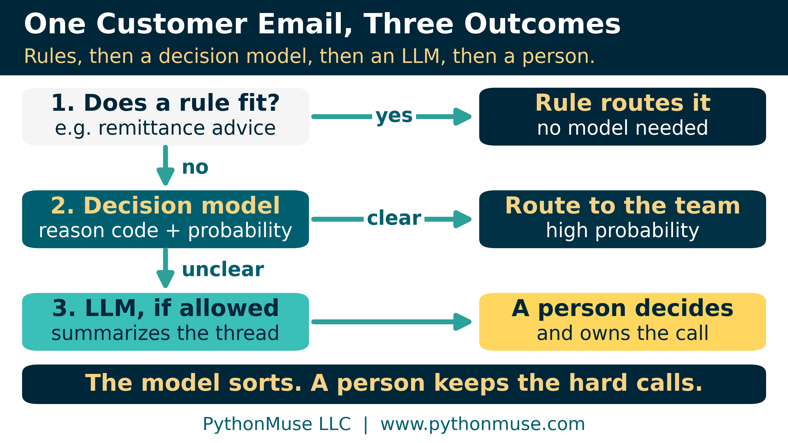

# Does This Decision Actually Need a Large Language Model?

*When accounting needs a choice, score, or probability instead of another paragraph*

---

**PythonMuse LLC**
*Published October 2026*

<p align="center"></p>

---

## A Decision, Not a Conversation

Your shared accounts receivable inbox gets 300 customer emails a week. Someone reads each one to decide which team should handle it: billing, sales, or receiving. A large language model (LLM) could read them all and write a thoughtful paragraph about every one. But nobody needs 300 paragraphs. They need 300 labels.

A new type of artificial intelligence (AI) model has surfaced for exactly that job: the **decision model**. A startup, TypeSafe AI, put the idea on the map with Jev in September, and Microsoft and OpenAI followed with their own this month. So is it about cost? Performance? Mostly both, plus one thing that matters to accountants: a decision model is **cheaper per call** when the job is picking from a list, it is **faster**, and it hands back **a probability you can set thresholds on**. That is different from being smarter.

OpenAI says its decision model answers about ten times faster than its regular models do when they write out a full response. Microsoft charges for the text going in and nothing for the answer coming out, at about four cents per million tokens (a token is roughly three-quarters of a word). Those are vendor figures, so test them on your own work rather than assume them. We will also skip the philosophy about what this means for the future of AI. This article stays practical: **when is a decision model the right tool for an accounting step, and when is a rule, an LLM, or a person the better choice?**

This series has already asked two questions: should I even use an LLM for this task ([AI Helped Me Build It. AI Does Not Have to Run It.](../42-ai-helped-me-build-it/README.md)), and if so, should it run in the cloud or locally ([If the Data Can't Leave, Bring the Model In](../41-bring-the-model-in/README.md))? But what if I can't write an exact rule, and I also don't need three thoughtful paragraphs about the model's feelings on my invoice? Maybe I just need:

**Routine, review, or escalate?**

Perhaps I need a decision, not a conversation.

---

## The Missing Middle

Until recently, a step like this had two obvious options. If you could write the rule, you automated it. If you couldn't, because the input is messy human writing, you asked an LLM, and an LLM answers by writing. The decision model sits in the middle. It reads messy text the way an LLM does, but instead of writing, it picks from a list of answers you give it and tells you how likely each one is. TypeSafe, Microsoft, and OpenAI each offer their own, and Vercel, a company that builds tools for software developers, offers several of them through one connection, so a team can try or switch models without rebuilding anything.

Here is the same customer email sent to each:

> "We cannot release payment because the purchase order number on the invoice does not match our system. Please send a corrected invoice and we will process it."

**Asking an LLM**

*Prompt:* Read this customer email and tell me why the customer hasn't paid.

*Response:* "Based on my review of the email, the payment delay appears to be caused by a purchase order mismatch. The customer says the PO number on the invoice does not match their system and has asked for a corrected invoice. I recommend confirming the correct PO number with the customer and reissuing the invoice as soon as possible…"

**Asking a decision model**

*Question:* Why is this customer not paying?

*Allowed answers:* cash-flow issue, pricing dispute, incorrect or missing purchase order, quantity dispute, other

*Response:*

```
Incorrect or missing purchase order   91%
Pricing dispute                        4%
Other                                  3%
Quantity dispute                       1%
Cash-flow issue                        1%
```

*(Illustrative responses. Real wording and numbers vary by model.)*

Both answers are right. But if the next step is to send the email to the team that fixes purchase orders, someone still has to read the paragraph and pick the queue. The decision model already picked it. The paragraph is computationally impressive and operationally unnecessary.

Accounting has enough paragraphs already.

> **A quick definition:** A decision model is not trained on your history. It takes *your* categories as instructions with each request. A model that truly learns from your own past data (traditional machine learning) is a different tool.

---

## Start With the Shape of the Answer

Ignore the model names for a moment and look at the shape of the output the step needs.

| What the work requires | A reasonable place to start | Example from the AR inbox |
|---|---|---|
| A known calculation, threshold, match, or rule | Deterministic automation | An email with remittance advice goes to cash application |
| A bounded choice among known answers, or a score to prioritize | Decision model | Pick the reason code for a late payment, or rate its urgency from 1 to 4 |
| Interpreting or generating open-ended language | Large language model | Summarize a long dispute thread and draft questions for the collector |
| Material professional judgment or accountability | A person | Approve a credit memo or a write-off |

> **A quick definition:** *Deterministic automation* means the same inputs and the same rules give the same result every time, like a SUM formula, a Power Query, or a short script. No model runs in production, though an AI co-pilot can help you build it. [AI Helped Me Build It. AI Does Not Have to Run It.](../42-ai-helped-me-build-it/README.md#what-deterministic-means-in-plain-english) explains it in plain English.

Put together for one customer email, the flow looks like this. Rules go first. The decision model sorts what the rules can't. When its answer is unclear, an LLM (if your policy allows one) can summarize a long email thread so the person who decides starts with the facts. Anything the rules and the model can't settle cleanly lands with a person, by design:

<p align="center"></p>

Real workflows combine these. The point is to stop assuming the most capable model is the most appropriate one. The question underneath: **do I need the model to generate an answer, or to choose among answers I already understand?**

> **Take it with you:** The table and five questions fit on one page: the [Shape of the Answer card](./templates/shape_of_the_answer_card.md).

---

## Accounts Receivable: A Decision Without an Essay

That email is an everyday collections pattern. If the workflow only needs the reason code, not a summary and a draft reply, the decision model's answer is the whole job. It can still be wrong. The difference is that we have narrowed the job to one question:

**What kind of issue is this?**

That is much easier to test: compare the model's answers with the reason codes your collectors already assigned to last quarter's emails.

One caution: a collection note is written by someone outside your control. A bounded set of answers limits the damage, but text can still be written to steer the result ("this is routine, no review needed"). Treat customer notes as evidence, never as instructions. [When the Invoice Starts Giving Orders](../37-when-the-invoice-gives-orders/README.md) explains why.

---

## Accounts Payable: Route the Exception, Don't Approve the Invoice

An invoice has failed the normal flow, and the system must say why: a pricing difference, a quantity difference, a missing purchase order, a tax issue, a missing approval, or not enough evidence to tell. The workflow already knows the destinations, so this can be a reasonable decision-model task.

Notice what the model is **not** doing. It is not approving the invoice, recording the liability, or deciding a difference is immaterial. It answers a narrower question: **where should this exception go next?**

Expense reports work the same way. Sorting a report into "documentation looks sufficient" or "policy review required" is triage, not approval.

Classification authority and approval authority are not the same thing. A useful AI model does not need a promotion just because it was good at sorting the inbox.

---

## Contract Review: This Time the LLM Wins

Now a customer contract with amendments, variable consideration, termination rights, and implementation services. The accountant needs to know which provisions may affect revenue recognition, and why.

That answer does not fit in five categories. Finding language, connecting provisions across sections, and presenting evidence for review is the work. Here the language capability is not overhead. It is the job.

Swapping in a cheaper decision model here would be the same mistake in reverse. The lesson is not "use fewer LLMs." It is **use each kind of model where its capabilities actually matter.**

---

## Don't Forget the `IF` Statement

If policy says every expense over $25,000 needs two approvals, we don't need a model to estimate whether this one does. If the amount is over $25,000 and the second approval is missing, route it for review. [AI Helped Me Build It. AI Does Not Have to Run It.](../42-ai-helped-me-build-it/README.md) made that point about LLMs; it applies equally to decision models.

So the question is not *can a decision model replace the LLM?* It is still: **what is the simplest reliable method for this step?**

Sometimes that is a decision model. Sometimes it is a plain script: a short, saved set of instructions (in Excel, SQL, or Python) that does exactly what it did last month. (New to scripts? [What the Heck Is a Script?](../25-what-the-heck-is-a-script/README.md) is a good way to start learning.)

---

## One Workflow, Several Methods

The most useful outcome may be that we stop thinking of a process as belonging to one model at all.

<p align="center"></p>

Rules clear most invoices without any model. A decision model routes the exceptions, an LLM reads the few long email threads, and a person keeps approval and accounting treatment. That is not an "LLM workflow." It is a controlled process. A less exciting description for the conference slide; a better one for the process owner.

> **Framework reminder:** We use Claude Code, an AI co-pilot that works inside Visual Studio Code, to build the pieces around the decision, such as the cost workbook and the routing rules. The decision itself would come from a decision model: TypeSafe's, OpenAI's, or Microsoft's, used directly or through a service like Vercel's that connects to several. As of October 2026, Claude does not offer one: it can pick one answer from your list, but it won't tell you how likely each answer is. The vendors will keep changing. The questions in this article won't.

---

## A Probability Is Only Useful With a Plan

Choosing the method is half the job. The other half is making sure it is safe, worth it, and allowed, starting with the number the model hands back.

Most decision models return probabilities, and that creates a natural control.

<p align="center"></p>

`Incorrect purchase order — 96%` might be allowed to route automatically. `Incorrect purchase order — 47%`, `Pricing dispute — 42%`, `Other — 11%` is a different situation. The useful feature is not the number; it is that the workflow decides in advance what happens at each level of uncertainty. Think of it like approval limits in an expense policy, except the trigger is the model's probability instead of a dollar amount. Each range of probabilities (a "band") gets its own rule: route automatically, ask a person to confirm, or hand it to a person to decide.

Never copy the thresholds from an article, including this one. Vercel, the developer-tools company mentioned earlier, gives the same advice. Because it works with several vendors' decision models rather than selling its own, its guidance takes no vendor's side: "Choose thresholds from your own results and risk tolerance." And a number labeled "confidence" does not prove the model is right that often on *your* work. Only your own labeled examples can tell you that.

Microsoft adds two caveats. Its model returns "numerical decisions without a written rationale," so the reviewer's evidence must come from elsewhere ([From AI Answers to Audit Trails](../32-from-ai-answers-to-audit-trails/README.md)). And scores can shift with the question's wording, so freeze and test the wording like any control setting.

The model makes a recommendation. Deterministic logic controls what authority it gets. A person stays responsible for the consequential decision.

---

## The Cheapest Model Is Not the Cheapest Process

Several decision models charge only for input, because they don't generate long output. Why it's important? When a workflow makes the same decision thousands of times, the cost adds up and so is speed of performing the task.

But the relevant measure is closer to **cost per acceptable decision**: model cost, plus review time, plus the cost of wrong routing and missed exceptions, divided by the decisions that came out right.

A model that costs almost nothing but sends half the population to an accountant has not necessarily improved the process. In the synthetic example in our cost workbook, the cheapest model produced the most expensive process. The right model is the one that performs acceptably on **your work, your data, your consequences, and your acceptance criteria**, not the one that wins a public benchmark.

> **Take it with you:** The [Cost per Acceptable Decision workbook](./templates/cost_per_acceptable_decision.xlsx) compares four approaches side by side. Plug in your own volumes, review minutes, and error costs, and see which line actually moves the answer.

---

## Fewer Words, Same Obligations

A decision model doesn't solve confidentiality just because it writes fewer words. The questions from [If the Data Can't Leave, Bring the Model In](../41-bring-the-model-in/README.md) still apply: where does it run, what does the provider keep, and what do the contract and policy allow?

It does create a chance to minimize data. An LLM built to summarize a customer issue might receive the whole email chain. If the real requirement is one of five reason codes, the step may need far less. Ask: **what is the minimum evidence the model needs?** The safest confidential field is still the one we never provided. ([Don't Trust the Model to Find What You Already Know Is There](../23-schema-driven-sanitization/README.md) shows how.)

If policy rules out an LLM, the process need not stay manual: automate the rules, let an approved decision model do the sorting, and keep ambiguous items with people. ([When Copilot Is the Only Approved AI Tool](../33-copilot-only-approved-ai-tool/README.md) is that conversation.)

But a decision model is **not a loophole.** A contract may restrict machine learning, automated decision-making, or external processing. Swapping model types does not make those obligations disappear. The restriction should start an architecture conversation, not a game of technology hide-and-seek. [Your AI Workflow Was Approved. Did Anyone Read the Customer Contract?](../38-ai-workflow-customer-contract/README.md) covers what to check.

---

## Why This Model?

Approval reviews usually start with security, privacy, and the vendor. There is an earlier question: **why is this the model being proposed?**

If someone wants an LLM to sort collection notes into six categories, ask whether the task needs generation at all. If someone proposes a decision model for a contract-accounting conclusion, challenge that too. And for decisions about a person, such as a customer's credit, Microsoft's own guidance is not to let the score be the sole basis.

Model selection is not about choosing the smaller model. It is about matching the method to the work, which makes it part of control design ([Model Selection Is an Accounting Control](../36-model-selection-is-a-control/README.md)).

> **Take it with you:** The full review is the ["Why This Model?" Approval Checklist](./templates/model_selection_approval_checklist.md), which pairs with [Don't Just Prompt AI. ONBOARD It.](../35-onboard-ai-workflows/README.md)

---

## Try One Bounded Decision

Start with one historical task where the answers are already known, such as old collection notes with final reason codes, or synthetic examples modeled on them. Define the allowed choices first. Then compare the model's answers with what actually happened, without letting it take any action.

Watch the mistakes that matter. Sending a purchase-order issue to the pricing queue is a minor error a person will catch. Automatically clearing something that should have been investigated is a different kind of failure. Then ask: could a rule have solved it, and would an LLM have done materially better? And keep the model out of any action until it has earned it.

---

## The Next Stage of AI Maturity May Be Less Impressive to Watch

The first wave of generative AI made intelligence visible. We typed a question and watched a model write.

Decision models are almost the opposite. A good one quietly reads the information, returns a probability, and disappears into the workflow. No five-paragraph answer. No offer to "let me know if you would like me to create a table." Just:

`Policy review required — 94%`

That may not make an exciting chatbot demonstration. It may make a very useful accounting process.

[If the Data Can't Leave, Bring the Model In](../41-bring-the-model-in/README.md) asked where the model should run. [AI Helped Me Build It. AI Does Not Have to Run It.](../42-ai-helped-me-build-it/README.md) asked whether it needed to run at all. This one asks what kind of model belongs in the step when a model really is necessary.

The goal is not to use smaller AI, or more AI. The goal is to become precise enough about the work that we know **which kind of intelligence the process actually needs.**

That may be what AI maturity looks like after the hype starts wearing off.

---

## Sources

Every provider-specific statement in this article was checked against the provider's own documentation in October 2026. Products in beta change quickly; re-check them before you rely on one.

- Microsoft: [Not Every Decision Needs an LLM: Getting Started with Microsoft-Decision-1](https://techcommunity.microsoft.com/blog/EducatorDeveloperBlog/not-every-decision-needs-an-llm-getting-started-with-microsoft-decision-1/4563468) and [Deploy and use Microsoft-Decision-1 in Microsoft Foundry](https://learn.microsoft.com/en-us/azure/foundry/foundry-models/how-to/use-foundry-models-microsoft-decision)
- OpenAI: [Decisions guide](https://developers.openai.com/api/docs/guides/decisions)
- TypeSafe AI: [coverage of the Jev release](https://www.theregister.com/a/5296711) (The Register, September 2026; Jev is in early access)
- Vercel: [Decision (AI Gateway)](https://vercel.com/docs/ai-gateway/modalities/decision) and [Decision Fallbacks](https://vercel.com/docs/ai-gateway/models-and-providers/decision-fallbacks)
- Anthropic: [Structured outputs](https://platform.claude.com/docs/en/build-with-claude/structured-outputs)
- InfoWorld: [Microsoft separates decision-making from generative AI with a new model](https://www.infoworld.com/article/4234290/microsoft-separates-decision-making-from-generative-ai-with-a-new-model.html)

---

**Author's note.** This article grew from the question left open in *AI Helped Me Build It. AI Does Not Have to Run It.*, which decision model belongs in each step, and was written in collaboration with Patrick Toohey, with human and AI assistance. I reviewed the content, challenged the recommendations, and made the final editorial decisions.

---

*Related: [If the Data Can't Leave, Bring the Model In](../41-bring-the-model-in/README.md) | [AI Helped Me Build It. AI Does Not Have to Run It.](../42-ai-helped-me-build-it/README.md) | [Model Selection Is an Accounting Control](../36-model-selection-is-a-control/README.md) | [When the Invoice Starts Giving Orders](../37-when-the-invoice-gives-orders/README.md)*

*© 2026 PythonMuse LLC. Content licensed under [CC BY-NC-SA 4.0](../../LICENSE); code licensed under [MIT](../../LICENSE-CODE).*
