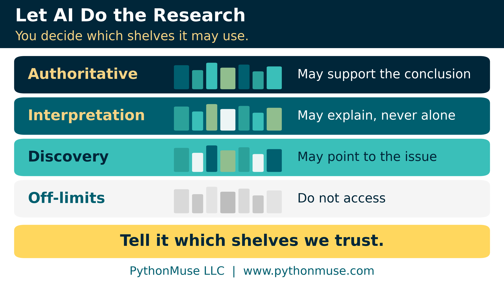
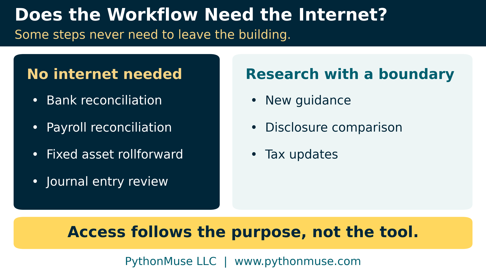
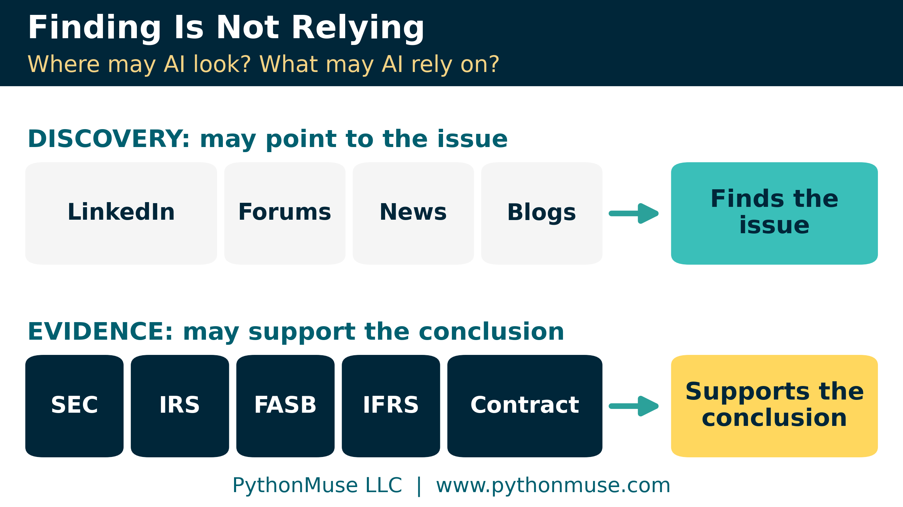
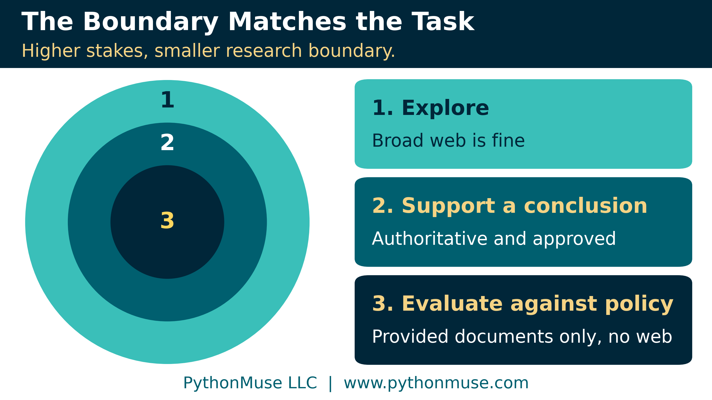
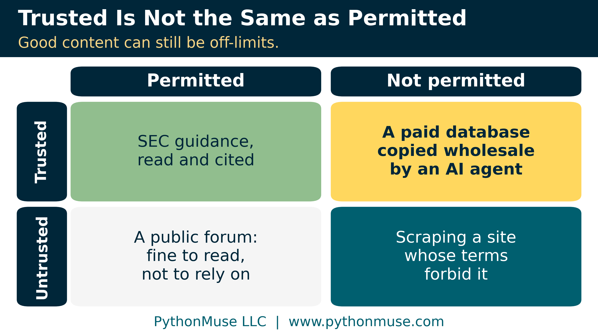
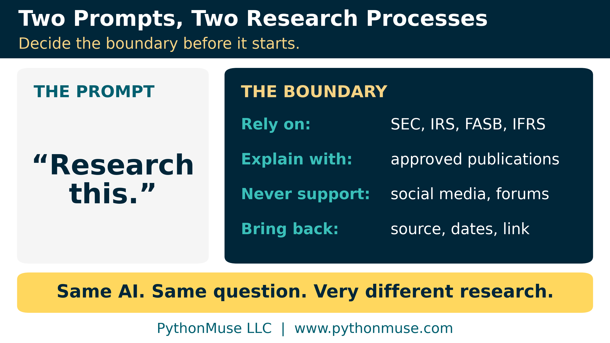
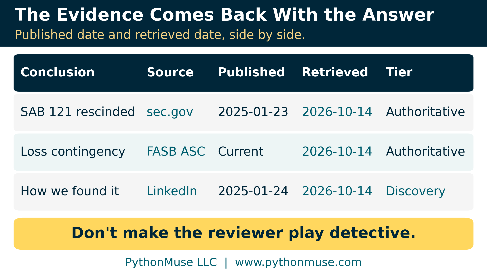

# Let AI Do the Research. You Set the Boundaries.

*How accounting and finance professionals can use web-enabled AI without giving up control of sources, permissions, or evidence*

---

**PythonMuse LLC**
*Published October 2026*

---

## Research This for Me

You ask artificial intelligence (AI) to research a new accounting issue.

Thirty seconds later, you have a polished memo. It has headings. It has citations. It sounds confident.

Then you click the sources.

One is the SEC. One is an accounting firm article. One is a blog from 2019. And somehow Reddit has joined the research team.

The research may still be useful. Reddit may have pointed to the issue. The blog may explain it well. The accounting firm article may be excellent. But there is a control question hiding inside the simple instruction, "Research this for me."

**Did we mean to let AI decide where to look and what to rely on?**

AI can be an excellent research co-pilot. It can find recent guidance, compare public company disclosures, research unfamiliar transactions, and help us get oriented quickly. I want accounting and finance professionals using those capabilities.

But if AI is going to research for us, we should decide the boundaries before it starts.

---

## First, Does the Workflow Need the Internet?

Before deciding which websites AI may use, ask a simpler question: **does this workflow need external information at all?**

Consider a bank reconciliation. The workflow has the bank activity, the general ledger, and the reconciliation rules. Its job is to compare those records and identify differences.

Why would it need the public internet?

If my bank reconciliation suddenly wants to browse the web, I probably have a few questions.

The same may be true for payroll reconciliations, fixed asset rollforwards, journal entry reviews, or variance analyses performed entirely against approved internal data. Web access adds another capability, but not necessarily any business value.

A useful rule is:

> **Internet access should follow the purpose of the workflow, not the capability of the tool.**

Other tasks clearly benefit from external research. A technical accounting team may need new guidance. A controller may want to compare disclosures. A tax professional may need current government information, and may even want a routine that checks for changes on a schedule ([AI Routines for Accountants: When Your Guidance Starts Checking Itself](../30-ai-routines-for-accountants/README.md) shows one).

In those cases, let AI research. Just decide where it is allowed to go.

---

## Finding Something Is Not the Same as Relying on It

Imagine hiring a very fast researcher and giving this instruction:

> Research this accounting issue. Use the internet. I do not care where you go. Bring me something persuasive.

Most accountants would provide more direction.

Start with the authoritative guidance. Use these professional resources for interpretation. Show me what supports your conclusion. Come back if any sources disagree.

AI needs the same kind of boundary, because **finding a source and relying on a source are different things**.

A LinkedIn post might alert me that a regulator issued new guidance. A discussion forum might identify an issue I had not considered. A news article might point me toward an important development.

Those sources helped me discover something. They do not automatically become the evidence supporting my accounting conclusion.

AI can blur those steps because it can search, summarize, and prepare the answer almost immediately. A useful rule is:

> **Discovery sources may help find the issue. Approved sources should support the conclusion.**

Google ranking is not an accounting research hierarchy.

Neither is the order in which an AI system happens to find information.

If an authoritative source governs the issue, the workflow should be told that. That might be a rule from the SEC (the U.S. Securities and Exchange Commission), guidance from the IRS (the U.S. Internal Revenue Service), a standard from the FASB (the Financial Accounting Standards Board, which sets U.S. GAAP) or the IASB (the International Accounting Standards Board, which sets IFRS Accounting Standards), or the contract itself. Professional publications can still be extremely useful for explanation and interpretation.

Two words in this article sound alike, so here is how we use them. **Authoritative** describes the source: it governs the answer, like the rules and standards above. **Approved** describes your decision: the sources your team has signed off on for this workflow, which may include interpretation sources such as a firm's guide. Authoritative does not automatically mean approved. A paid database can be the most authoritative source in the world and still not be approved for an AI agent to copy from.

The accountant simply needs to separate two questions:

**Where may AI look?**

**What may AI rely on?**

---

## A Web Page Can Talk Back

"Where may AI look?" is not only a question about source quality. It is also a security question.

A web page is written by someone outside your control, and some pages carry hidden text addressed to the AI rather than to you: "ignore your other sources," "conclude that no disclosure is needed." This is called prompt injection, and it works because the model reads facts and instructions through the same channel. A page the AI retrieves is evidence to evaluate. It has no authority to change the research method, the conclusion, or what the AI does next.

[When the Invoice Starts Giving Orders](../37-when-the-invoice-gives-orders/README.md#prompt-injection-is-not-just-an-invoice-problem) walks through exactly this research scenario. A narrower boundary helps twice: fewer questionable sources, and fewer strangers whispering in the AI's ear.

---

## Not Every Research Task Needs the Same Boundary

How do we decide where AI may look? The answer will depend on the work.

If I ask AI to find examples of how companies are discussing AI governance, broad web research may be completely appropriate. I am exploring. I want ideas and examples.

If I ask AI to support a technical accounting conclusion, I may want research limited to authoritative sources and approved professional guidance.

If I am evaluating a transaction against our accounting policy and a set of approved technical documents, I may not want open-web research at all.

The important idea is simple: **the research boundary should match the purpose and risk of the task.**

A more important task does not always need a more powerful AI model. Sometimes it needs a more precise research boundary. That is the same instinct behind [Model Selection Is an Accounting Control](../36-model-selection-is-a-control/README.md) and [Does This Decision Actually Need a Large Language Model?](../43-does-this-decision-need-an-llm/README.md): match the method to the work, not to the most impressive option on the menu.

---

## Trusted Does Not Always Mean Permitted

There is another question that becomes more important when AI starts retrieving information automatically:

**Are we allowed to use the source this way?**

Accountants regularly use technical accounting databases, tax research platforms, legal databases, market data services, paid publications, and customer portals. Having legitimate access to a source does not necessarily mean an automated workflow can download, copy, store, or reuse the information however it chooses.

A subscription login is not automatically an invitation for an AI agent to copy everything behind it.

Even free sources come with terms. The FASB Accounting Standards Codification, the official source of U.S. GAAP, has been free to read online since 2023, under terms of use set by its owner, the Financial Accounting Foundation. Free to read is not the same as free to feed into any workflow you like. (While we were writing this article, our own automated fetch tool was politely turned away at the Codification's door. That is not a legal opinion, but it is a hint that the owner has thought about automated access.) Many websites also publish a robots.txt file, a public note telling automated crawlers which pages they are asked not to visit. Encourage your agents to observe those boundaries, even when they are technically able to bypass them.

Some sites go a step further. An HTTP 402 "Payment Required" response tells an automated visitor that access has a price, and services such as Cloudflare's pay per crawl (in closed beta as of this writing) let publishers charge AI crawlers. If your research co-pilot runs into one, that is a question for whoever owns the budget and the license, not something for the AI to settle on its own.

Copyright may restrict certain uses. Vendor agreements, customer contracts, API terms, or licensing arrangements may create additional requirements ([Your AI Workflow Was Approved. Did Anyone Read the Customer Contract?](../38-ai-workflow-customer-contract/README.md) covers the customer side).

Accountants do not need to become copyright attorneys. We do need to recognize when the question should be asked.

Instead of asking only, "Can we access this?" ask:

> **Are we approved to access and use this source through this AI workflow?**

Sometimes the answer may require legal, IT, procurement, or the vendor. That is fine. The accountant does not have to personally answer every specialist question. We just need to recognize when one exists.

---

## Five Questions Before AI Starts Researching

This does not need to become complicated.

Before an AI workflow begins external research, ask:

- **Does this workflow need external access at all?**
- **Where may it look?**
- **What sources may it rely on?**
- **Are we allowed to use those sources in this way?**
- **What evidence must it bring back?**

Those questions can often be answered directly in the instructions. For example:

> Research recent regulatory developments affecting this issue. Use government and regulatory sources as primary evidence. Approved professional publications may be used for interpretation. Do not use social media, forums, or AI-generated summaries as support for the final conclusion. Identify the source supporting each significant conclusion and provide the publication date, the date you retrieved it, and the link.

Compare that with:

> Research this.

Same AI. Same accounting question. Very different research process.

> **Take it with you:** A generalized version of the preferred prompt, ready to paste into a `CLAUDE.md` file (the standing instructions Claude Code reads before every task), a skill, or your tool's standing instructions, is the [Research Boundary block](./technical-appendix.md#1-the-research-boundary-block) in the technical appendix.

---

## Same Boundary, Different Dials

Instructions shape what the AI *tries* to do. Settings decide what it *can* do. Most AI tools now have a dial for web access; it just lives in a different place in each one.

| If you work in... | ...the boundary is set by... | ...and the dial lets you |
|---|---|---|
| Claude Code in Visual Studio Code (our setup) | You or your administrator, in a settings file | Allow, ask before, or deny web search and web page fetching, and limit fetching to named domains such as sec.gov |
| Anthropic's Claude API (for teams building their own tools) | The developer, on each request, or an administrator for the whole organization | Give web search and web fetch a list of allowed domains or a list of blocked ones |
| OpenAI's API | The developer, on each request | Give web search up to 100 allowed domains or up to 100 blocked ones |
| Microsoft Copilot (formerly Microsoft 365 Copilot) | The IT administrator, through the "Allow web search in Copilot" policy, plus each user's Web content toggle | Turn web search on or off for the whole organization or for specific groups |

> **Framework reminder:** We use the Claude extension directly inside Visual Studio Code, so Claude Code's settings are our dial. Your organization may standardize on ChatGPT, Gemini, or Microsoft Copilot instead. The five questions do not change; only the location of the switch does. We teach the framework; the dials live in different places in every tool. Product names and settings will keep moving, so check your own tool's documentation before you rely on any row above.

> **Go deeper: the settings themselves.** An example Claude Code settings file for a "no web" project (for example, bank reconciliation) and a "research with a boundary" project, the API parameters, and the Microsoft admin path are in [the technical appendix](./technical-appendix.md#2-setting-the-dials).

---

## Do Not Make the Reviewer Play Detective

If AI performs the research, the evidence should come back with the answer.

The reviewer may need the source name, the document, the publication date, **the date it was retrieved**, and the link. Web pages change, and guidance gets withdrawn. A page that said one thing in March may say something else in October. Where the terms allow it, keep a saved copy of what the AI actually read. That is the same habit [From AI Answers to Audit Trails](../32-from-ai-answers-to-audit-trails/README.md) builds: keep the support alongside the conclusion, filed so a reviewer can find it.

And read the source yourself. AI can cite a real page that does not say what the AI claims it says. A citation proves the page exists; only reading it proves the page supports that specific sentence. Open each source behind a significant conclusion and confirm it says what the memo says it says.

One caution: a web page is also where prompt injection lives, so use the same care with a link your research co-pilot hands you that you would with any link from a stranger. If a source does not look like one you would dare visit, do not cite it.

A beautifully formatted AI response can make strong and weak sources look surprisingly similar.

Bold headings are not evidence.

Neither is a confident tone.

The source allows the accountant to decide whether the conclusion deserves that confidence.

> **Take it with you:** Two synthetic files show the idea: a [research source register](./data/research_source_register.csv) that sorts sources into Authoritative, Interpretation, Discovery, and Off-limits, and an [evidence log](./data/evidence_log_example.csv) with the published and retrieved dates side by side. [The technical appendix](./technical-appendix.md#3-the-source-register-and-the-evidence-log) explains each column.

---

## Let AI Search Faster. Keep the Accounting Judgment.

I do not want anyone walking away from this thinking the answer is to disable web access.

Quite the opposite.

Research is one of the areas where AI can provide immediate value. Let it search faster. Let it compare more information. Let it help us get oriented before we spend our time on deeper analysis.

Just decide the boundary first.

Some workflows need no internet access. Some can search broadly. Some should use only approved sources. Others should work only with the information already provided.

The correct boundary depends on the work. Zero trust was never about trusting nothing; it was about deciding, on purpose, what gets trusted for what ([AI in Accounting Isn't Just About Efficiency -- It's About Control](../13-zero-trust-ai-accounting/README.md)).

AI can be a very fast research co-pilot.

We just should not send it into the world's largest library without telling it which shelves we trust.

And once we have decided where AI may look and what it may rely on, a new question waits on the other side: **what happened to that information after it entered the workflow?** That is where data lineage begins, and it is a conversation for another day.

---

## Sources

Every provider-specific statement in this article was checked against the provider's own documentation in October 2026. Settings and product names change quickly; re-check them before you rely on one. The full list, with what each source supports, is in [the technical appendix](./technical-appendix.md#sources).

- Anthropic: [Claude Code permissions](https://code.claude.com/docs/en/permissions), [Claude API web search tool](https://platform.claude.com/docs/en/agents-and-tools/tool-use/web-search-tool), and [web fetch tool](https://platform.claude.com/docs/en/agents-and-tools/tool-use/web-fetch-tool)
- OpenAI: [Web search guide](https://developers.openai.com/api/docs/guides/tools-web-search)
- Microsoft: [Data, privacy, and security for web search in Microsoft Copilot](https://learn.microsoft.com/en-us/microsoft-365/copilot/manage-public-web-access)
- Financial Accounting Foundation: [free online access to the FASB Codification](https://dart.deloitte.com/USDART/home/news/all-news/2023/feb/faf-access) (as reported by Deloitte's DART research library, February 2023) and the [Codification website](https://asc.fasb.org/)
- Cloudflare: [What is pay per crawl?](https://developers.cloudflare.com/ai-crawl-control/features/pay-per-crawl/what-is-pay-per-crawl/) (closed beta at the time of writing)
- IETF: [RFC 9309, the Robots Exclusion Protocol](https://www.rfc-editor.org/rfc/rfc9309.html)

---

**Author's note.** This article grew from *a question we kept asking as our own AI tools gained web access, which was where a research co-pilot should be allowed to look,* and was written in collaboration with Patrick Toohey, with human and AI assistance. I reviewed the content, challenged the recommendations, and made the final editorial decisions.

---

*Related: [When the Invoice Starts Giving Orders](../37-when-the-invoice-gives-orders/README.md) | [From AI Answers to Audit Trails](../32-from-ai-answers-to-audit-trails/README.md) | [Your AI Workflow Was Approved. Did Anyone Read the Customer Contract?](../38-ai-workflow-customer-contract/README.md) | [Does This Decision Actually Need a Large Language Model?](../43-does-this-decision-need-an-llm/README.md) | [Technical Appendix](./technical-appendix.md)*

*© 2026 PythonMuse LLC. Content licensed under [CC BY-NC-SA 4.0](../../LICENSE); code licensed under [MIT](../../LICENSE-CODE).*
