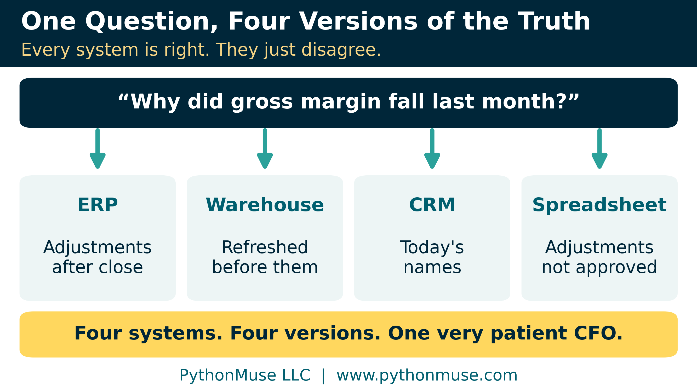
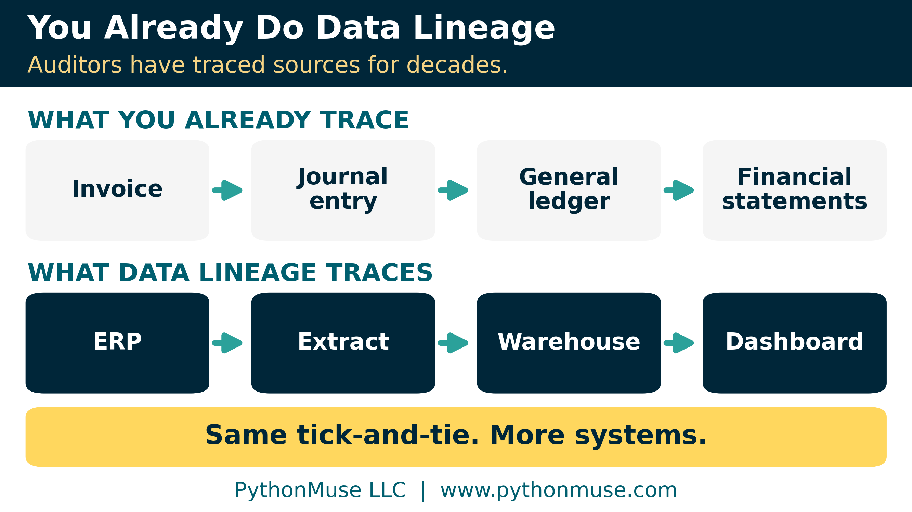
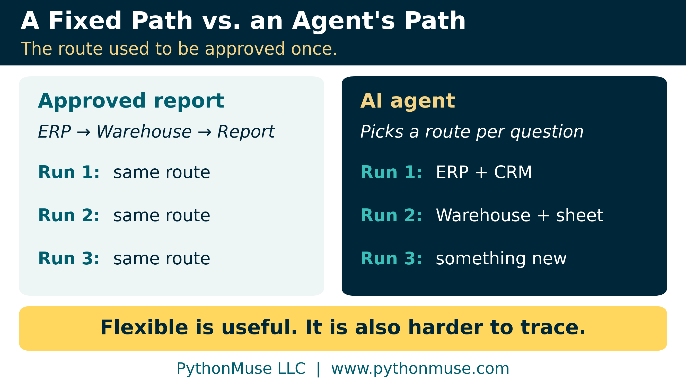
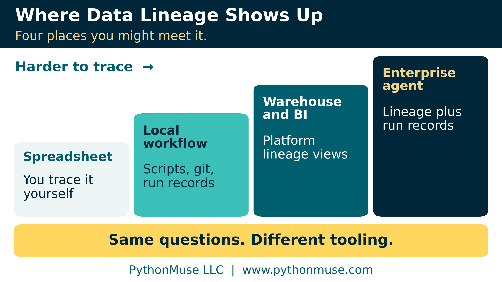
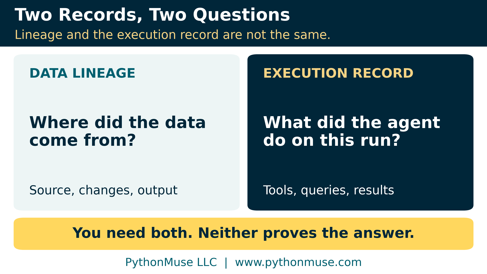
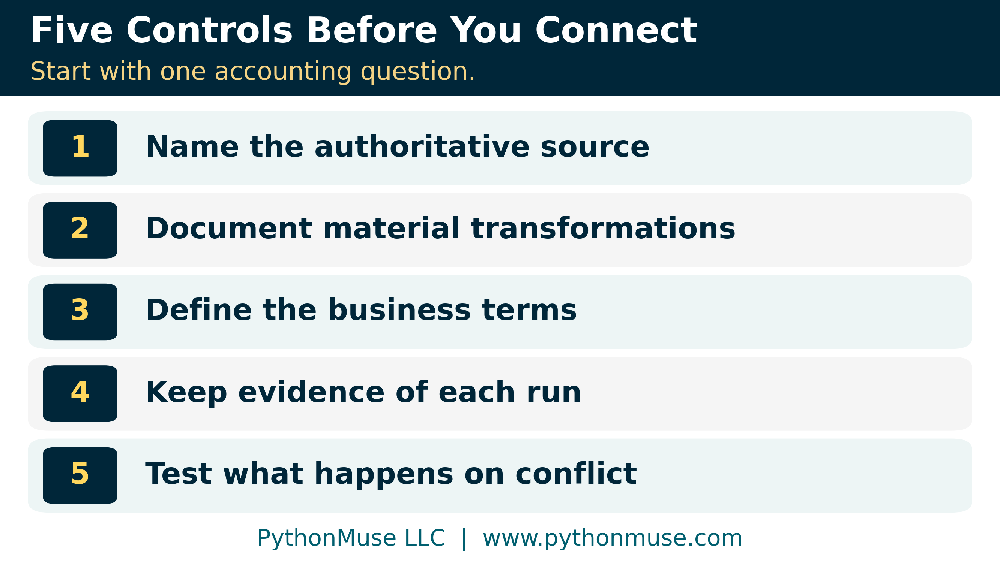

# When AI Leaves the Sandbox: Why Data Lineage Becomes an Accounting Problem

*An AI agent can access all your systems and still give you the wrong answer. The problem may not be the AI.*

---

**PythonMuse LLC**
*Published November 2026*

---

## When Everyone Has the Right Numbers, but Nobody Agrees

Imagine a CFO asking an AI agent a simple question: "Why did our gross margin decline last month, and which customers contributed most?"

The agent can reach the ERP (the enterprise resource planning system that holds the general ledger), the data warehouse (the central database the reporting team builds dashboards from), and the CRM (the customer relationship management system Sales lives in). Within minutes, it returns a beautifully organized analysis of variances, customer trends, and likely causes.

Sounds wonderful. We may finally get through a month-end review without another spreadsheet!

But there is a problem.

The ERP includes adjusting entries posted after month-end. The warehouse was last refreshed before those adjustments. The CRM uses today's customer names, while the ledger still carries historical customer IDs. And someone in Finance keeps a separate spreadsheet of management adjustments that have not been approved yet.

Every system holds legitimate business information. The agent can retrieve all of it, and its arithmetic may be flawless. But the four systems do not describe the same version of financial reality. Four systems, four versions of the truth, one very patient CFO.

Which revenue figure should the agent use? Were customers mapped correctly? Were the unapproved adjustments included? And if the CFO questions the result, can anyone show where the numbers came from?

Welcome to data lineage.

> **A quick definition:** *Data lineage* is the record of where a number came from, what happened to it along the way, and where it ended up. It is the audit trail, drawn for data instead of for transactions.

> **Related read:** [Let AI Do the Research. You Set the Boundaries.](../44-ai-research-boundaries/README.md) decided where AI may look and what it may rely on. This article follows the information after it enters the workflow.

---

## You Already Do Data Lineage

If the term sounds like a job for the data engineers, here is the good news: accountants have done it for their entire careers. We just never put "data" in front of it.

You click a cell in Excel, choose **Trace Precedents**, and arrows show every cell that feeds it. That is lineage, with arrows.

You tick and tie a number on the financial statements back to the trial balance, the general ledger, the journal entry, and the invoice. That is lineage, with a red pen.

Auditors formalized it. When a company hands its auditor a system report, say a listing of fixed asset additions, the auditor cannot simply trust it. Audit teams often call this IPE, information produced by the entity. AS 1105, the audit evidence standard of the PCAOB (the Public Company Accounting Oversight Board, which oversees the auditors of U.S. public companies), calls it "information produced by the company" and expects the auditor to test its accuracy and completeness, or the controls over it. A PCAOB staff spotlight from April 2024 says it is important for the auditor "to identify the sources of the underlying data in reports as well as how the reports are generated."

That sentence is data lineage. It just never introduced itself.

The skill is not new. What AI changes is how many systems sit in the chain, and how often the chain changes.

---

## Data Lineage Is Not New. The AI Problem Is.

In a traditional reporting environment, transactions start in the ERP, get extracted, are transformed in a data warehouse such as Snowflake, and appear in a dashboard such as Microsoft Power BI. A lineage record connects those steps: which source tables fed the dataset, which transformations were applied, which reports depend on the result. If an account mapping changes, lineage shows which reports need another look.

So why is everyone suddenly talking about it?

Because the path used to be fixed. Finance approved a report's sources and calculations once, and the report took the same route every month.

An AI agent may choose its own route. It might use the ERP for one analysis and the warehouse for the next, or join CRM names to ledger transactions. Ask a similar question tomorrow and it may take a different path entirely.

That flexibility is useful. It also raises a control question: which information shaped this answer, and was it the right source for the question?

**Access is not understanding. Giving an agent access to company information is not the same as giving it reliable information and the business context to use it correctly.**

---

## Where Data Lineage Shows Up in Your Work

My own controlled workflows didn't seem to have the problem everyone was describing, which made the lineage conversation confusing at first. The reason is that lineage looks very different depending on where you stand. Here are four places you might meet it.

**1. The spreadsheet.** Lineage lives in formulas and links, and you trace it yourself. Difficulty: low, right up until someone pastes values over the formulas, or links to a file that lives only on a former colleague's desktop.

**2. The controlled local workflow.** This is PythonMuse home turf: a project in Visual Studio Code with scripts, input files, and git (the tool that records every change to the code). In a bank reconciliation, AI helps write and test the matching scripts; once approved, the monthly run is deterministic, so no model is needed to run it ([AI Helped Me Build It. AI Does Not Have to Run It.](../42-ai-helped-me-build-it/README.md) tells that story). One honest gap: git remembers every change to the code, but not which bank file was used in March. A simple run record closes it ([Reproducible Accounting](../05-reproducible-accounting/README.md) covers the habit). Difficulty: manageable, because we drew the boundaries.

**3. The BI and data warehouse stack.** ERP to extract to warehouse to dashboard, with a data team owning the pipelines. Here the platforms often draw the map for you: Power BI's lineage view shows which sources feed which reports and when each dataset was last refreshed, and Snowflake, dbt (a tool data teams use to build transformations in the warehouse), and Microsoft Purview (Microsoft's data governance catalog) all draw lineage graphs. OpenLineage is an open standard for collecting lineage across tools. Difficulty: moderate. The map exists, but someone in Finance still has to say which dataset is authoritative for what.

**4. The enterprise AI agent.** The agent reaches many systems through APIs (the doorways one system offers another), MCP servers, or vendor connectors, and chooses its path per request. Lineage explains how the datasets were built; you also need a record of what the agent did on this run. Difficulty: highest, because the map is redrawn for every question.

The questions never change: where did it come from, what happened to it, and is it the right source for this purpose? Only the tooling does.

### Same Question, Different Connectors

How an agent reaches your business systems depends on the tool your organization uses.

| If you work in... | ...the agent reaches other systems through... |
|---|---|
| The Claude Code extension in Visual Studio Code (our setup) | MCP servers, added for you alone or shared with the whole project |
| ChatGPT and OpenAI's Codex | MCP servers; ChatGPT lists custom ones as plugins, subject to your workspace's policies |
| Microsoft Copilot (formerly Microsoft 365 Copilot) | Copilot connectors, which either copy external data into Microsoft's index of your organization's content or fetch it live through MCP; Copilot Studio agents can also use MCP tools |
| Gemini Enterprise | Connectors that either copy data from Google and third-party sources into its own index on a sync schedule, or query the source live |

Notice that some connectors copy data into an index on a schedule. That copy is one more stop on the lineage map, with its own refresh timing: the stale-warehouse problem from our CFO story, wearing a different badge.

> **Framework reminder:** Our own examples use the Claude Code extension directly inside Visual Studio Code. Your organization may standardize on ChatGPT, Microsoft Copilot, or Gemini instead. The connector names differ; the lineage questions do not. We teach the framework, and it applies in any tool. Product names change quickly, so check your own tool's documentation before relying on any row above.

---

## An MCP Connection Is Not a Data Governance Strategy

Back to our CFO. Suppose the agent reaches the warehouse through an MCP server. MCP, the Model Context Protocol, is an open standard for connecting AI applications to outside systems ([From Reports to Requests](../34-model-context-protocol-for-accounting/README.md) explains it for accountants). Snowflake, for example, offers a managed MCP server, generally available since November 2025, and its documentation notes that access to the MCP server does not give access to the tools behind it. Even the vendor separates the front door from the rooms.

That is useful technology. But the connection does not establish whether the data is complete, current, or right for the question. If the warehouse holds yesterday's results and the ERP holds today's adjustments, both return valid answers. The agent needs context to know which one to use, and the same goes for account mappings, customer hierarchies, and reporting periods.

### Two Records, Two Questions

Two different records help here, and they are easy to confuse.

**Data lineage** answers: where did this data come from, and how was it shaped before the agent ever saw it?

**The execution record** answers: what did the agent actually do on this run? Which tools did it call, which queries did it run, what came back, and what supports each claim? Some platforms keep part of this for you; Snowflake's access history, for example, links each query to the user who ran it and the tables and columns it read. [From AI Answers to Audit Trails](../32-from-ai-answers-to-audit-trails/README.md) builds the reviewer's side of the habit.

We need both. Neither one guarantees the financial conclusion is correct. That still takes a professional.

---

## Why AI Pilots Look Successful but Struggle in Production

A pilot usually starts narrow: a reliable dataset, defined expected results, controlled conditions. The demo works. Leadership is delighted.

Then someone asks: "Can we connect this to all our systems?"

Suddenly, business units turn out to keep separate customer records, old account mappings are poorly documented, and two data owners each believe theirs is the authoritative source.

The agent did not create these problems. It exposed them, by crossing boundaries people had been navigating with experience and institutional knowledge. An experienced accountant knows the sales dashboard is not where recognized revenue lives, and that one subsidiary's numbers are not final until the third business day. An agent has to be told, through definitions, approved sources, documented rules, and controlled tools ([Metadata Is the Label Maker Your AI Workflow Needs](../31-metadata-is-the-label-maker/README.md) shows one way to write it down).

One caution in the other direction: demanding complete lineage across the whole enterprise before testing a single workflow creates a governance project so large that nobody ever gets to use AI. That should not be the starting point.

---

## Start With the Accounting Question, Not the Technology

Suppose Finance wants an agent to explain monthly revenue variances. Before connecting every system, ask what the agent actually needs. Which dataset holds approved revenue? How often is it refreshed? Does it include consolidation adjustments? Which source wins when two disagree?

These are accounting questions, not software questions. For this use case, I would start with five controls.

**Name the authoritative source.** Identify where approved figures originate and who owns them. The ERP may be authoritative for posted transactions, while a controlled consolidation process owns consolidated results.

**Document material transformations.** Keep the mappings, filters, calculations, and adjustments between the original transactions and what the agent receives. Not every technical detail, but every material step.

**Define the business terms.** Tell the agent what revenue means here (invoiced, recognized, gross, or net?), which periods apply, and how customer IDs relate across systems.

**Keep evidence of each run.** Retain inputs, queries, tool actions, outputs, and validation results, so a reviewer can connect every material claim to its support.

**Test what happens on conflict.** Hand the agent an outdated report, an unmatched customer ID, or two different revenue figures. Does it flag the problem, follow an approved rule, or confidently invent a resolution? I would rather find out in testing than in the CFO's quarterly review.

Start with one workflow and expand as sources are added. A small team may need only a source register and a review record; a larger one may use data catalogs and lineage platforms. The technology differs. The questions do not.

> **Take it with you:** A synthetic [source register](./data/source_register_template.csv) fills in the gross-margin example: one row per source, with its owner, what it is and is not authoritative for, its refresh timing, its cutoff rule, its key transformations, and whether it is approved for AI use. The rows are illustrative only; replace them with your own.

---

## What This Means for Accountants

As AI gets better at working across systems, accountants become more important to how financial information is interpreted, not less.

We know preliminary and final results are not interchangeable, that classifications differ between entities, and that a reconciled number can still land in the wrong category. IT and data engineers build the connections and run the lineage tools. Finance defines the authoritative sources, the business rules, and what counts as acceptable evidence. Nobody needs to master every data platform; we need to bring the control knowledge we already have into the design of AI workflows.

That is also why we keep recommending smaller, controlled processes before autonomous ones ([You Built an AI Workflow. What Happens If You Win the Lottery?](../40-builder-to-production/README.md) covers the path to production). A repeatable script that reliably completes a reconciliation may deliver more value than an ambitious agent that needs six systems to answer one question.

Sometimes the less exciting solution is the one that actually makes it into production.

---

## Final Thought: Follow the Data Before Trusting the Answer

Data lineage is not a new accounting concept dressed up in AI terminology. It is a discipline accountants and auditors have practiced for decades, and it matters more as AI learns to retrieve, combine, and act on information across systems.

The answer is not necessarily another platform, or waiting for perfect data. Start with one accounting process. Identify its authoritative sources. Understand the transformations. Write down the business rules. Then design the AI workflow so its results can be traced, validated, and reviewed.

**The real challenge is not giving AI access to more information. It is making sure AI uses the right information, understands what it represents, and leaves enough evidence for us to verify the result.**

And once we can trace the data from source to accounting output, one more question waits: what actually happened inside the AI workflow while it was running? That is the world of logs and telemetry, and it is a conversation for another day.

---

## Sources

Every product and standard mentioned in this article was checked against its owner's own documentation in November 2026. Features, editions, and product names change quickly; re-check them before you rely on one.

- PCAOB: [Spotlight: Inspection Observations Related to Auditor Use of Data and Reports](https://assets.pcaobus.org/pcaob-dev/docs/default-source/documents/data-and-reports-spotlight.pdf) (April 2024), which quotes AS 1105.10 and contains the "sources of the underlying data" sentence
- Microsoft: [Display the relationships between formulas and cells](https://support.microsoft.com/en-us/office/display-the-relationships-between-formulas-and-cells-a59bef2b-3701-46bf-8ff1-d3518771d507) (Trace Precedents), [Data lineage in Power BI](https://learn.microsoft.com/en-us/power-bi/collaborate-share/service-data-lineage), [Data lineage in Microsoft Purview](https://learn.microsoft.com/en-us/purview/data-gov-classic-lineage), [Microsoft 365 Copilot connectors overview](https://learn.microsoft.com/en-us/microsoft-365/copilot/extensibility/overview-copilot-connector), and [Extend your agent with Model Context Protocol in Copilot Studio](https://learn.microsoft.com/en-us/microsoft-copilot-studio/agent-extend-action-mcp)
- Snowflake: [Data lineage](https://docs.snowflake.com/en/user-guide/ui-snowsight-lineage), [Access history](https://docs.snowflake.com/en/user-guide/access-history), [Snowflake-managed MCP server](https://docs.snowflake.com/en/user-guide/snowflake-cortex/cortex-agents-mcp), and its [general availability release note](https://docs.snowflake.com/en/release-notes/2025/other/2025-11-04-cortex-agents-mcp) (November 4, 2025)
- dbt Labs: [Discover data with Catalog](https://docs.getdbt.com/docs/explore/explore-projects) (the lineage graph)
- OpenLineage: [project home page](https://openlineage.io/)
- Model Context Protocol: [What is MCP?](https://modelcontextprotocol.io/docs/getting-started/intro)
- Anthropic: [Use Claude Code in VS Code](https://code.claude.com/docs/en/vs-code) (connecting MCP servers)
- OpenAI: [Model Context Protocol in ChatGPT and Codex](https://learn.chatgpt.com/docs/extend/mcp) and [Connect and test your plugin](https://developers.openai.com/plugins/deploy/connect-chatgpt)
- Google Cloud: [Introduction to connectors and data stores in Gemini Enterprise](https://docs.cloud.google.com/gemini/enterprise/docs/connectors/introduction-to-connectors-and-data-stores)

---

**Author's note.** This article grew from *my own confusion about why data lineage kept coming up in enterprise AI conversations when the controlled workflows we build in Visual Studio Code didn't seem to have the problem,* and was written in collaboration with Patrick Toohey, with human and AI assistance. I reviewed the content, challenged the recommendations, and made the final editorial decisions.

---

*Related: [Let AI Do the Research. You Set the Boundaries.](../44-ai-research-boundaries/README.md) | [From Reports to Requests](../34-model-context-protocol-for-accounting/README.md) | [From AI Answers to Audit Trails](../32-from-ai-answers-to-audit-trails/README.md) | [AI Helped Me Build It. AI Does Not Have to Run It.](../42-ai-helped-me-build-it/README.md)*

*© 2026 PythonMuse LLC. Content licensed under [CC BY-NC-SA 4.0](../../LICENSE); code licensed under [MIT](../../LICENSE-CODE).*
