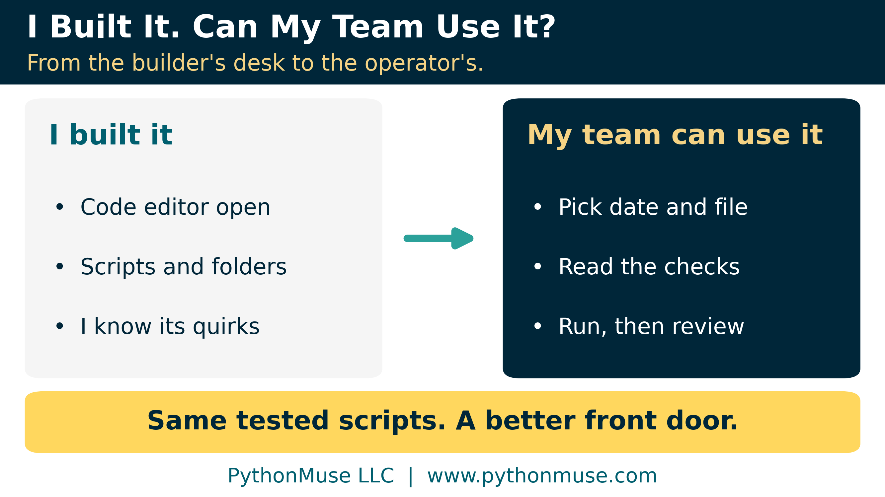
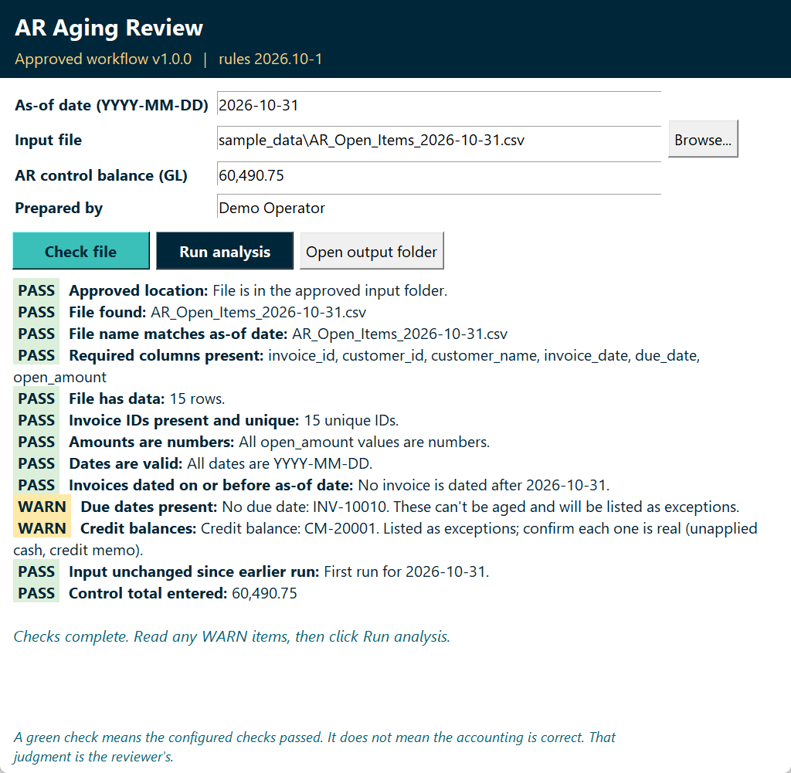
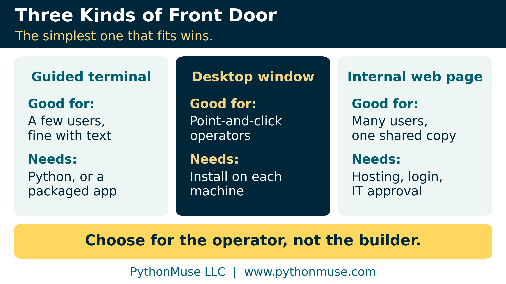
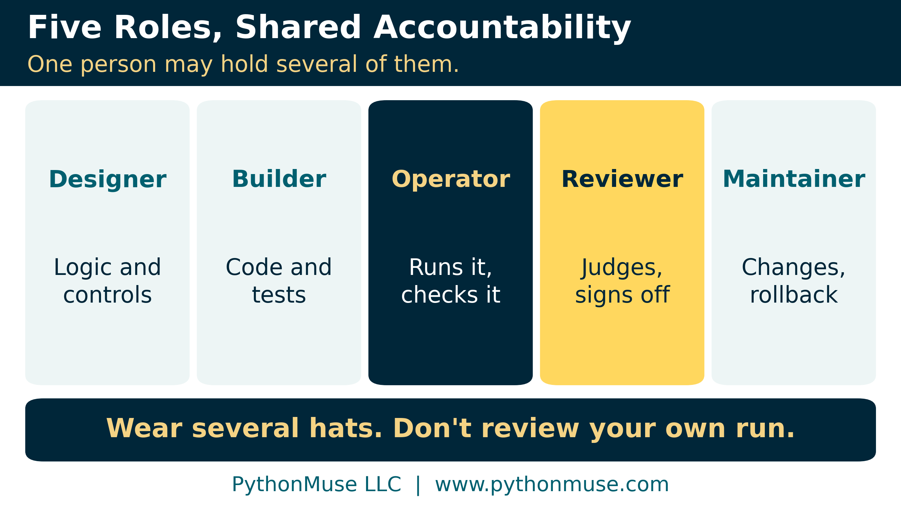
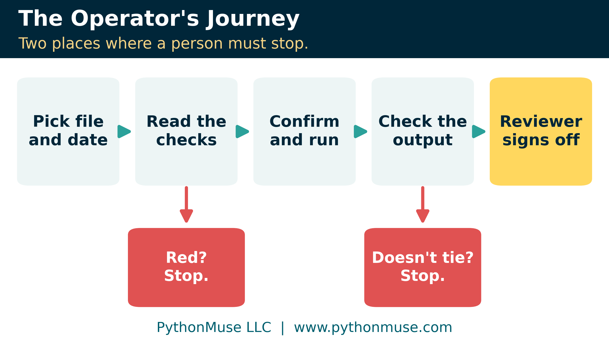
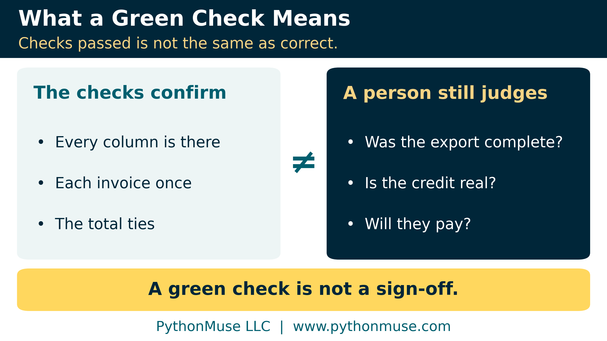
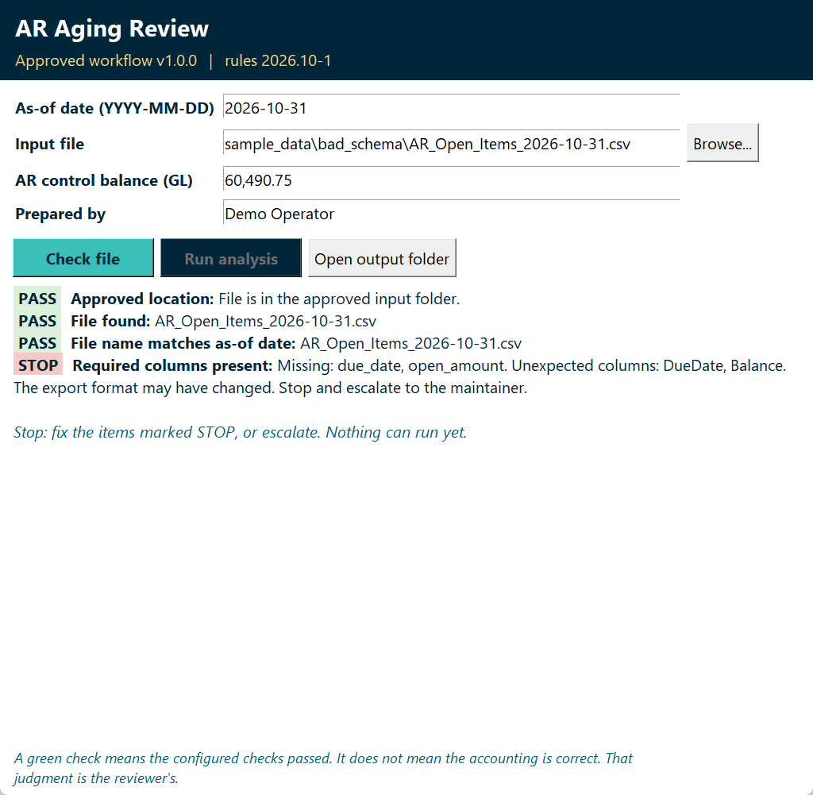

# I Built the Workflow. Now How Does My Team Use It?

*The first PythonMuse Lab: handing an AI-built accounting workflow from the person who built it to the people who run it*

---

**PythonMuse LLC**
*Published November 2026*

---

I was showing Juan, who told me I could call him JJ, how I work with artificial intelligence (AI) to build accounting workflows. While JJ was excited, he asked the question that eventually comes up on any team: "Great. So how does the rest of your team use a workflow you build?"

Fair point. I knew which folder to open, which script to run, and what to do with the result once the workflow generated it. An accountant on a team would not necessarily know any of that, and shouldn't need three months of training to learn it.

This Lab is about that gap. By the end, you'll know how to give a workflow you built a front door your team can use, who should run it and who should review it, and how to test the handoff before you trust it. The takeaway: **as AI changes how accounting work gets done, we won't all need the same technical skills. We will all need to understand our responsibilities, how our workflows operate, and how to validate the results.**

> **This is a PythonMuse Lab.** Understand → Implement → Experiment. This article is the *Understand* layer and stands on its own. If you want to build it, [the technical appendix](./technical-appendix.md) is the *Implement* layer, and [the companion demo](https://github.com/PythonMuse/pythonmuse-ar-operator-handoff-demo) is the *Experiment*: a small, tested AR aging review with synthetic data that you can run yourself.

I'm trying something new with this one. Each Lab pairs a story you can read without touching code with a technical guide and, when the topic earns it, a working example. Read as far as your curiosity takes you.

---

## Not Every Accountant Needs to Be a Builder

In a recent presentation, I shared where I think our profession is heading. As the tools keep changing, we'll need people with different responsibilities. Some will design workflows. Some will build them. Some will operate them, review the results, and make the accounting decisions. And someone will have to maintain what we build when the ERP gets upgraded on a Tuesday and nobody told the script.

These aren't necessarily new job titles, and in a small department one person may wear every hat. [From Reports to Requests](../34-model-context-protocol-for-accounting/README.md#a-new-accounting-team-structure) sketched a similar team structure. But the roles matter, because we can't expect every accountant to become a developer. Nor should we expect the person who builds a workflow to personally run every process they've automated, forever, including the week they're on vacation.

---

## Building It Is Only Half the Journey

Picture it. You spent a few days with an AI co-pilot building an automated AR aging review. You described the requirements. It helped you write the Python scripts and document the business context in Skills. You tested the results, corrected mistakes, added validation steps, and finally reached the point where the process works reliably. Wonderful.

But you're the builder. You know the folder structure, which script to run, which date to change, and that the export has to be saved as a CSV (a plain comma-separated text file) or everything falls over. Your AR specialist doesn't.

Think about the systems we already use. An accounts payable specialist doesn't need to know how the ERP was programmed to enter an invoice. They need to understand the transaction, the system's controls, and how to confirm their work was processed correctly. Why should a workflow we build ourselves be any different?

[You Built an AI Workflow. What Happens If You Win the Lottery?](../40-builder-to-production/README.md) asked whether someone else *could* run your workflow from its documentation. This Lab takes the next step: what should running it actually *feel* like for that person, and how do you find out whether it works for them?

---

## Give the Operator a Better Front Door

One approach I've found useful is surprisingly simple. Once the workflow is built and tested, I ask the AI co-pilot to help create a small interface for the person who will operate it. Sometimes it's a guided terminal window that asks a few questions. Sometimes it's a small application window with fields, instructions, and a button.

Here's the AR example end to end. On the second business day of the month, the AR specialist exports the AR Aging report from the ERP and saves it in the approved folder with the predefined name convention. Then they open an application called **AR Review**. They enter the as-of date, choose the file, type in the ending AR balance from the general ledger, and click **Check file**.

The window checks whether the file is in the right place and with the right naming convention, has the right columns, belongs to the right month, lists each invoice once, and has sensible amounts and dates. Anything red stops the process with a message saying what to fix or whom to call. Anything amber is listed for the operator to read. Only when nothing is red does **Run analysis** switch on. Behind that button, the same tested scripts do the work and save an Excel workpaper with the aging, the exceptions, the reconciliation, and a record of exactly which file and which rules produced it.

If you have ever used an Excel dashboard that runs on macros, you already know this pattern. The person who refreshes it each month rarely knows how the macro works. They know where to save the data, which cell to check, and which button to push. Somebody else wrote the macro, and the operator trusts it because the instructions are clear and the totals are checked afterward. This is the same idea, with two upgrades: the scripts behind the button are tested against known answers, and the window stops the run when the file is wrong instead of producing a confident-looking dashboard from the wrong data.

That screenshot isn't a mockup. It's the companion demo's desktop window, checking a synthetic October file. The two amber lines are deliberate: one invoice has no due date, and one customer has a credit balance. Somebody should look at both.

No code editing, no conversation with an AI model, and no need to know how Python runs a function. No model is needed to *run* this. An AI co-pilot helped build it, test it, and will help maintain it, which is the point [AI Helped Me Build It. AI Does Not Have to Run It.](../42-ai-helped-me-build-it/README.md) made at length.

Pick the simplest front door that fits the operator, not the one the builder finds most fun to make.

> **Go deeper: choosing the front door, and the architecture behind it.** How the three options compare, what each needs from IT, and why the accounting rules live in a separate file instead of the interface are in [the technical appendix](./technical-appendix.md#3-choosing-the-operator-interface).

---

## Different Roles, Shared Accountability

The **designer** understands the accounting problem and defines what the workflow should accomplish and which controls it needs. The **builder** turns that into working, tested scripts and skills, with help from AI. The **operator** prepares the inputs, runs the approved process, validates the results, and handles routine exceptions. The **reviewer** brings independent oversight and professional judgment, and signs off. The **maintainer** keeps the workflow reliable as systems, rules, and business conditions change.

One person can hold several of these. The one combination to avoid is operator and reviewer of the same run. Nobody should mark their own homework, however good the homework is.

An operator isn't someone who just pushes a button. They're an accounting professional who understands the purpose of the workflow, notices when something is off, and knows what evidence supports the result. That knowledge may be worth more than knowing how to write the workflow scripts underneath it.

So what does the operator actually check once the workflow run finishes?

- **Tie the total to the control balance.** The aging total should equal the AR balance in the general ledger. If it doesn't, stop.
- **Check the customer count.** Thirty customers when you usually have three hundred means the export was cut off, however tidy the totals look.
- **Read the credits and the missing due dates.** A credit might be unapplied cash, a duplicate credit memo, or a typo. An invoice with no due date can't be aged at all.
- **Spot-check a sample of *unflagged* items.** The exceptions list only shows what the rules were told to look for. In the demo, one invoice sits at exactly 90 days past due, one day short of the flag. Nothing on the screen will point at it. A curious operator will.

> **Go deeper: the operator guide and the review gate.** A one-page operator procedure, what the reviewer checks, and where sign-off is recorded are in [the technical appendix](./technical-appendix.md#8-review-gates).

---

## A Button Doesn't Make It Production-Ready

This is the part of the conversation I don't want anyone to skip. A friendly interface isn't the same thing as a controlled production process. The window makes the right path easy. It isn't a control by itself, and it isn't a security boundary: anyone who can open the folder can open the files. The workflow still needs appropriate access permissions, approved business rules, tested calculations, documentation, a way to catch errors, and a process for managing changes.

And then there's the green check. **A green check means the checks passed, not that the accounting is right.** The checks can confirm that every column is there, each invoice appears once, and the total ties. They can't tell you whether the export was complete, whether the credit is real, or whether a customer 120 days late is ever going to pay. Those are judgments, and judgments belong to people.

What happens when the ERP export changes and two columns get new names? A good front door refuses to run and says so plainly. The operator recognizes the problem and escalates instead of improvising. The maintainer fixes the workflow, tests the change, and releases an approved version. That's where the roles start working together. (And knowing whether each run actually happened, and what it did, is its own control: [Your AI Workflow Is Running. Who Is Watching It?](../47-ai-workflow-monitoring/README.md) covers the logs and monitoring side.)

> **Go deeper: the controls behind the front door.** The input contract (what blocks a run and what only warns), how each run records its input file and rules version, why nothing is ever overwritten, and what a production version would need on top of the demo are in [the technical appendix](./technical-appendix.md#4-input-contract).

> **Framework reminder:** Our own examples are built with the Claude extension directly in Visual Studio Code, which is how this Lab's demo, launcher, and desktop window were made. You can make the same request in OpenAI's Codex extension for Visual Studio Code, in GitHub Copilot's agents in Visual Studio Code (often the natural route in Microsoft-standardized organizations), or in Gemini Code Assist's agent mode from Google (in preview as of this writing). PythonMuse teaches a framework you can use in any tool: whichever co-pilot builds the front door, the accounting rules stay behind it, and a person still checks what comes out. Product names and features change quickly, so check your own tool's documentation.

---

## Try It Monday: The Builder Challenge

We sometimes make AI adoption more intimidating than it needs to be. Some accountants will want to be builders; I'm certainly enjoying that part. Others will prefer to operate reliable workflows, investigate exceptions, or review conclusions. There's room for all of them.

So here's the challenge, for the builders. Take a workflow you rely on and hand it to a colleague who has never opened a [harness](../17-skills-and-agents-for-accountants/README.md#the-missing-piece-a-harness-for-ai), the workspace such as Visual Studio Code where the builder works with AI, files, and scripts. Give them the instructions, a good sample file, and a second file you've broken on purpose (say, one with a missing column or the wrong month). Then sit on your hands and watch. Can they find the right input, run the process, understand the results, catch the broken file, and know whom to call, all without asking you to explain the code?

If not, don't assume they need more technical training. Perhaps your workflow needs a better front door. The best way to design one is to ask the people who will walk through it. Ask your colleague what they would want to see on that first screen: where to save the file, what to type in, what the button should say, and what a helpful error message looks like. You may be surprised how different the answers are from what the builder would have guessed.

And if you're not a builder, remember that you don't have to become one to benefit from what AI makes possible. You do need to understand what the process is doing and how to validate the work.

> **Go deeper: running a handoff test.** A simple checklist for the test, including which broken files to prepare, is in [the technical appendix](./technical-appendix.md#12-test-the-handoff-not-just-the-code).

Then try both front doors of [the companion demo](https://github.com/PythonMuse/pythonmuse-ar-operator-handoff-demo) yourself, and try breaking them. I'd also love to hear how your team handles this handoff today.

**The goal isn't to turn every accountant into a developer. It's to make the technology we build usable, reliable, and accountable in the hands of the people doing the accounting.**

Thank you, JJ, for the conversation and for asking the question that started this Lab.

---

## Sources

Every product and tool statement in this article was checked against the provider's own documentation in November 2026. The full, dated list is in [the technical appendix](./technical-appendix.md#sources).

---

> **Author's note.** This article grew from *a conversation with JJ, who asked what happens after you've built a workflow that works and need your team to use it,* and was written in collaboration with Patrick Toohey, with human and AI assistance. I reviewed the content, challenged the recommendations, and made the final editorial decisions.

---

*Related: [From One-Time Analysis to Repeatable Workflows](../11-one-time-to-repeatable-workflows/README.md) | [When to Trust AI to Run Your Accounting Workflows](../12-audit-ready-ai-workflows/README.md) | [What the Heck Is a Script?](../25-what-the-heck-is-a-script/README.md) | [From AI Answers to Audit Trails](../32-from-ai-answers-to-audit-trails/README.md) | [From Reports to Requests](../34-model-context-protocol-for-accounting/README.md) | [Don't Just Prompt AI. ONBOARD It.](../35-onboard-ai-workflows/README.md) | [You Built an AI Workflow. What Happens If You Win the Lottery?](../40-builder-to-production/README.md) | [AI Helped Me Build It. AI Does Not Have to Run It.](../42-ai-helped-me-build-it/README.md) | [Your AI Workflow Is Running. Who Is Watching It?](../47-ai-workflow-monitoring/README.md) | [Technical Appendix](./technical-appendix.md)*

*© 2026 PythonMuse LLC. Content licensed under [CC BY-NC-SA 4.0](../../LICENSE); code licensed under [MIT](../../LICENSE-CODE).*
