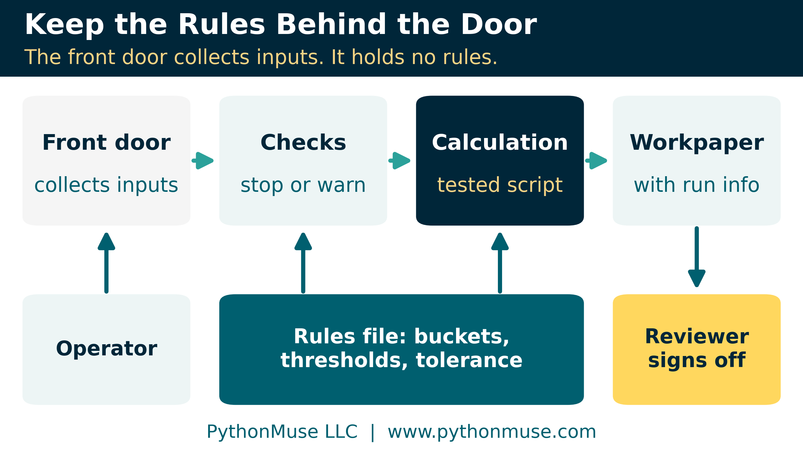
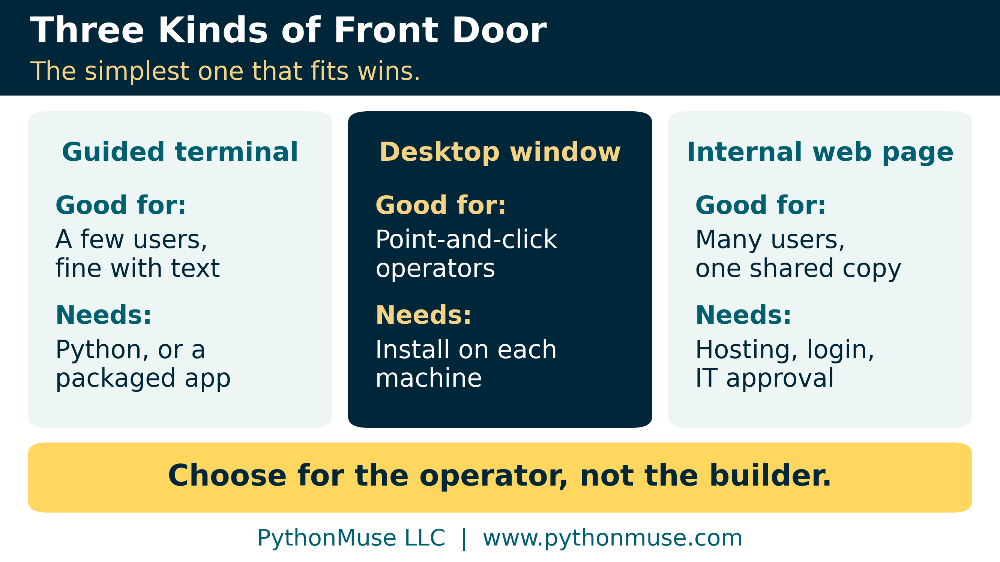
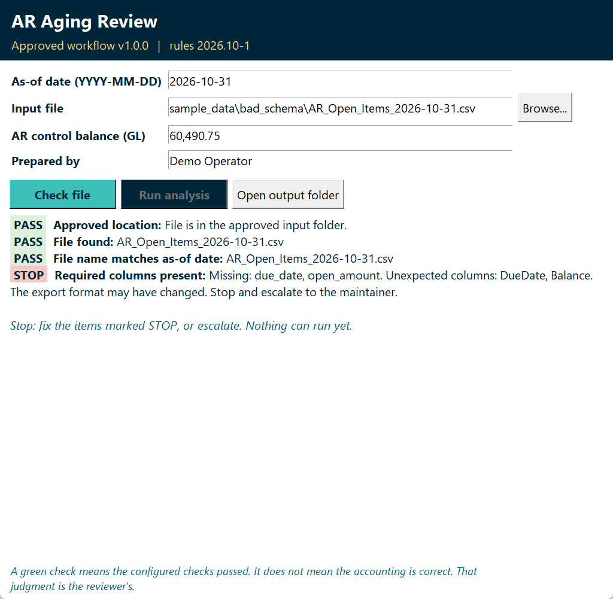

# Team-Ready Workflows: The Technical Appendix

*The technical appendix for _I Built the Workflow. Now How Does My Team Use It?_: the architecture, the three kinds of front door, the input contract, evidence and review, packaging, maintenance, and a handoff test*

---

**PythonMuse LLC**
*Published November 2026*

---

This page is for readers who want to build an operator-friendly front door for a workflow of their own, or review one someone else built. [The article](./README.md) stands on its own; nothing here changes its argument. Think of this as the workpapers behind the memo.

> **Part of a PythonMuse Lab.** [The article](./README.md) is the *Understand* layer. This appendix is *Implement*. A companion demo is coming as the *Experiment*: a small, tested AR aging review with synthetic data, two front doors, and one calculation script. The sections below describe that demo; the screenshots and figures come from it.

> **A note on tools:** Even as a builder, you don't need to memorize anything on this page. It's here so you understand what a good handoff contains and can recognize one when you see it. When you build with an AI co-pilot, you don't have to pick the interface toolkit or design the architecture yourself. Describe the finished product in detail, and who will use it, and let the co-pilot propose how to get there. Be especially clear that the people running it won't have an AI harness (the workspace, such as Visual Studio Code, where a builder works with AI, files, and scripts) installed, and may not have a license for an AI model at all. For example:
>
> *"Build a simple front door for this tested AR aging workflow. The people running it are AR specialists who don't have Visual Studio Code or any AI tool installed and don't have a license for an AI model. They should pick the as-of date and the export file, see plain-English checks, and only be able to run when nothing is red. The output is an Excel workpaper with the aging, the exceptions, the reconciliation, and a record of which file and rules produced it. Don't change the calculation scripts. Before you build anything, explain your recommended approach and what IT would need to install."*
>
> Then use the sections below to review what it proposes. And once the front door works, ask your co-pilot for one more thing: a short email to IT listing the minimum software the operators' machines need to run it (for example, the Python version and the packages it relies on), where the files should live, and who needs access. You review it, correct anything that doesn't match your environment, and send it yourself. IT gets a clear request instead of a mystery, and you get a record of what was approved.

A few terms used throughout:

- **Builder:** the person who wrote and tested the workflow, often with an AI co-pilot.
- **Operator:** the person who runs it each period and checks the result.
- **Reviewer:** the person, independent of the operator, who judges the accounting and signs off.
- **Maintainer:** the person who changes the code or the rules, tests the change, and releases it.
- **Front door:** the interface the operator uses (a guided terminal window, a desktop window, or a web page).
- **Deterministic:** given the same input and rules, the code produces the same output every time. No AI model is involved in the run.

---

## 1. Who This Is For and What You Need

**Who:** builders handing a workflow to colleagues, IT partners asked to support one, and reviewers deciding whether to rely on its output.

**What you need to follow along:** a working, tested script (or the companion demo once it is published), Python 3.10 or later, and permission from IT to install it where operators can reach it.

**Demo-only versus production:** the demo shows the *shape* of a controlled handoff with synthetic data on one machine. It does not supply access control, hosting, change management, backup, or software distribution. Those belong to your organization, and each section below says which ones it leaves to you.

---

## 2. The Architecture in One Picture

<p align="center"></p>

The flow is: **front door → checks → calculation → workpaper → review**, with the accounting rules in a separate **rules file** that the checks and the calculation script read.

- **Front door:** collects only approved inputs (as-of date, file, control balance, the operator's name). It contains no accounting logic.
- **Checks (validation):** decide whether the file may be run at all.
- **Calculation script:** performs the calculation. This is what the article calls "the tested scripts," and it is deterministic. It knows nothing about windows or buttons.
- **Workpaper:** the output, with the evidence of what produced it.
- **Review:** a person, independent of the operator.

The point of the separation is that each part can change without breaking the others. When the controller changes the 90-day threshold, the maintainer edits one line in the rules file; nobody redesigns the window. When the team wants a desktop window instead of a terminal, nobody touches the calculation. In the demo, both front doors call the same two functions ("check" and "run"), and an automated test fails if either front door tries to reach the calculation directly, so the two can never disagree about the accounting.

---

## 3. Choosing the Operator Interface

<p align="center"></p>

Choose for the **operator**, not the builder. An interface is not a control and not a security boundary: it makes the right path easy, but anyone with access to the folder can still open the files.

| If the operator would be best served by... | ...it looks like this | ...and it needs this from IT |
|---|---|---|
| A **guided terminal launcher** | A text window that asks for the date, the file, and the control balance, shows the checks, and asks "Run? (y/n)" | Python installed (or a packaged executable) on the operator's machine |
| A **small desktop window** | Fields, a file picker, a Check button, a Run button that only switches on when nothing is red | The same, plus the desktop toolkit; one install per machine |
| An **internal web page** | A browser page on the company network | A server, authentication, access control, monitoring, and someone who owns all of that |

**Tkinter for the desktop window.** Tkinter is Python's interface to the Tk toolkit for building simple windows. The Python documentation describes it as an optional module; the python.org installer for macOS includes a native version of Tk, and the traditional Windows installer installs Tcl/Tk support by default. Some Linux distributions package it separately (on Debian it is `python3-tk`). Running `python -m tkinter` opens a small test window if it is installed. If it is missing, the Python documentation's advice is to check with whoever provided your copy of Python.

**Packaging with PyInstaller.** PyInstaller is an open-source tool that bundles a Python program and its dependencies into an application, so operators don't need to install Python. Its own documentation is clear that it is not a cross-compiler: to make a Windows app you run it on Windows, to make a macOS app you run it on a Mac, and so on. Code signing, and how your security software treats an unfamiliar executable, are conversations for IT before anything is distributed.

**Streamlit for a web page.** Streamlit is an open-source Python library for building browser-based apps. Its free Community Cloud hosting is a public service: an app deployed from a public GitHub repository is public by default, and one deployed from a private repository is private to the workspace's developers until someone makes it public. That makes it a fine place to share a demo with synthetic data and the wrong place for client or company financial data. An internal web front door needs internal hosting, authentication, and governance agreed with IT.

---

## 4. Input Contract

The input contract is the list of conditions a file must meet before the workflow will touch it, like the checklist a reviewer runs on a client's trial balance before any analytics start. Every rule either **blocks** the run (stop; nothing happens until the file is fixed or replaced) or **warns** (the run may continue; the item is listed for the operator to read).

| The demo checks that... | If not, it... | Because... |
|---|---|---|
| The file is in the approved input folder | Blocks | Files from someone's Downloads folder are not the approved source |
| The file name matches the as-of date (`AR_Open_Items_2026-10-31.csv`) | Blocks | September's file picked for October is the most common honest mistake |
| All required columns are present | Blocks, and says "stop and escalate" | A renamed column usually means the ERP export changed |
| The file has data rows | Blocks | An empty export is not a clean month |
| Every invoice ID is present and appears once | Blocks | Totals can't be trusted while an invoice is counted twice |
| Amounts are plain numbers, dates are YYYY-MM-DD | Blocks, listing each bad line | Silent conversion is how 1,250.00 becomes 1.25 |
| No invoice is dated after the as-of date | Blocks | Usually the wrong period's export |
| Every line has a due date | Warns; the line is listed and not aged | An undated invoice can't be aged, but the rest of the file can |
| No line has a credit balance | Warns; the line is listed | Credits may be real (unapplied cash) or errors |
| If this as-of date was already run, the file is the same one used then | Blocks if it differs | A changed file for a closed period needs an explanation, not a quiet re-run |
| A control balance was entered | Warns if missing | Without it, the run can't reconcile |

<p align="center"></p>

The synthetic sample files include these problems on purpose: a duplicate invoice ID, a schema break, last month's file, a hand-edited amount, a missing due date, and a credit. You can read the [synthetic October input file](./data/AR_Open_Items_2026-10-31.csv) now; it opens or downloads from the link.

---

## 5. Rules and Configuration

The rules live in a small, plain-text configuration file in YAML (a human-readable settings format), not in the code and not in the interface. In the demo it holds the aging buckets (Current, 1-30, 31-60, 61-90, Over 90 days past due), the exception thresholds (more than 90 days past due; a customer balance above 25,000.00), the reconciliation tolerance (0.00), the file-name pattern, and the approved input folder. All values are illustrative only, not a recommendation.

- **Who can change it:** the maintainer, after the rules owner (typically the controller) approves.
- **How changes are recorded:** every change gets a new rules version number, and that version prints on every workpaper, so a reviewer can see exactly which rules produced the result.
- **Operators never edit it.** If an operator is asked to change a threshold, that's an escalation, not a task.

---

## 6. The Calculation Script

The calculation script does five things, in this order:

1. **Ages each open item.** Days past due = the as-of date minus the due date.
2. **Assigns each item to a bucket** (Current, 1-30, 31-60, 61-90, Over 90).
3. **Totals** each bucket, each customer, and the whole file.
4. **Lists exceptions** using the thresholds in the rules file.
5. **Reconciles** the aging total to the AR control balance.

The script lists items for a person to review. It makes no collection, reserve, or write-off decisions.

**The exact cutoff days and amounts are where rules quietly go wrong,** so the demo tests each one on purpose:

| Case | Result |
|---|---|
| Due *on* the as-of date (0 days past due) | Current |
| Exactly 30 days past due | 1-30 bucket |
| 31 days past due | 31-60 bucket |
| Exactly 90 days past due | 61-90 bucket, **not** an exception |
| 91 days past due | Over 90 bucket, an exception |
| Customer balance of exactly 25,000.00 | Not flagged |
| Customer balance of 25,000.01 | Flagged |

**Known answers.** For the October sample file, the expected results were calculated by hand, line by line, *before* any test was written. The tests check the code against those numbers, not against whatever the code happened to produce.

| Bucket | Expected total |
|---|---|
| Current | 27,750.00 |
| 1-30 days | 14,000.00 |
| 31-60 days | 7,350.50 |
| 61-90 days | 6,575.25 |
| Over 90 days | 4,175.00 |
| No due date | 640.00 |
| **File total** | **60,490.75** |

The file has 15 lines, 7 customers, and 6 exceptions.

---

## 7. Output and Evidence

Each run writes an Excel workpaper with seven sheets:

- **Summary:** run status, bucket totals, counts, and the reminder that a green check is not a sign-off.
- **Exceptions:** each item, with blank *Disposition* and *Reviewer notes* columns to complete.
- **Reconciliation:** aging total, control balance, difference, tolerance, result.
- **Validation:** every check and its result.
- **Detail:** every line with its days past due and bucket, for spot-checking unflagged items.
- **By Customer:** aging by customer.
- **Run Info:** run ID, timestamp, as-of date, operator, input file name and fingerprint, rules version and fingerprint, code version, status, and blank sign-off fields. (A fingerprint is a short code calculated from a file's exact contents; change one character and the code changes. It proves which file was used without revealing what's in it.)

**No silent overwrites.** Each run gets a new numbered file (`run01`, `run02`), and an existing workpaper is never replaced. Every completed run, including ones that don't reconcile, adds a line to an append-only run log, which serves as the output manifest. The log stores the input file's fingerprint, not the data itself.

**Status is explicit.** A run ends as *checks passed, ready for review*; *reconciliation difference, stop and escalate*; or *no control total, reconcile before review*. A blocked file produces nothing at all.

**Tip: write the Excel formatting rules down once, as a reusable skill.** When you design the workpaper, ask your co-pilot to help you create a [skill](../15-ai-and-excel-files/README.md#what-is-a-skill-for-excel) (a saved set of written instructions the co-pilot follows every time) that defines how every Excel output should look, so each workpaper from every workflow looks and behaves the same. Useful things to put in it:

- **Headers:** font, fill color, bold, frozen header row, and column widths that fit the content.
- **Amounts:** thousands separator, two decimals, no dollar sign, and a consistent way to show negatives. Decide once, and the whole team reads every workpaper the same way.
- **Calculated cells as Excel formulas, not pasted values.** Totals, subtotals, differences, and anything else that is a calculation should be exported as a live formula, such as `=SUM(...)`. A column of pasted numbers looks the same but can't be traced; a reviewer can click a formula and see exactly which cells it adds up. I learned this the hard way: with pasted totals, the reviewer has to re-add every column by hand to prove it ties.
- **Plain numbers and dates:** store amounts as numbers and dates as dates, never as text, so sorting, filtering, and formulas work.

Keep one rule in mind: formulas help the reviewer see how a figure was built, but the control total still comes from outside the workpaper, so the reconciliation still ties to the general ledger and not just to itself.

---

## 8. Review Gates

The reviewer, who should be independent of the operator, looks at:

1. **The reconciliation.** The aging total equals the general ledger AR balance, within the stated tolerance.
2. **Completeness.** The line and customer counts are plausible for the period.
3. **Every exception and its disposition.** Credits, missing due dates, items over the threshold, customers over the review limit.
4. **A sample of unflagged items.** The exceptions list only shows what the rules were told to find. Pick a few lines from different buckets on the Detail sheet and trace them to the source. In the demo, INV-10007 sits at exactly 90 days, one day short of the flag, and is a good test of whether anyone looks beyond the list.
5. **The run information.** The right as-of date, the expected rules version, and a fingerprint that matches the approved export.

Sign-off is recorded in the *Reviewed by*, *Review date*, and *Reviewer conclusion* fields on the Run Info sheet, or in your team's usual review record. The companion demo will include a one-page operator guide with the same checks from the operator's side, including when to stop and escalate.

A green check means the configured checks passed. It does not mean the accounting conclusions are correct.

---

## 9. Execution Environment and Packaging

- **Pinned dependencies.** The demo pins exact versions of its two libraries (openpyxl, which writes the Excel workpaper, and PyYAML, which reads the rules file), so the same code behaves the same way next year.
- **Approved paths.** The code checks that the input is inside the approved folder, but real protection comes from folder permissions set by IT.
- **No arbitrary commands.** The front doors run one approved workflow. They do not accept free-form commands.
- **No network and no AI calls at runtime.** The workflow never sends accounting data anywhere. A workflow that doesn't need AI to run has no reason to send production data to a language model just because AI helped write the code.
- **Packaging.** If operators shouldn't install Python, a packaged executable (see [Choosing the Operator Interface](#3-choosing-the-operator-interface)) is built on each target operating system and distributed through IT's normal process.

---

## 10. Access, Maintenance, and Rollback

- **Owner:** a named role owns the code, the tests, and the rules file.
- **Updates:** a new version is tested (including the known-answer tests), tagged, and released; the code version prints on every workpaper.
- **Rollback:** reinstall the previous tagged version. Because each workpaper records the code and rules versions, you can tell which runs used which release.
- **A run that fails mid-way** writes nothing. A run that used the wrong file or rules is never edited after the fact: mark it superseded in the review record, fix the cause, and re-run.
- **Corrected exports:** re-running a period that already has a run, with a corrected file, is a maintainer action that records the reason on the workpaper and in the run log. The demo's desktop window deliberately doesn't offer it; operators escalate, maintainers act.

---

## 11. Where AI Fits (and Where It Doesn't)

An AI co-pilot helped design, build, and test every part of this: the validation rules, the calculation script, the workpaper, both front doors, the sample data, and the tests. It can keep helping with maintenance: explaining a failing test, drafting a rules change for review, or adding a new check when the export changes.

At runtime, no model is needed. The aging is arithmetic and the checks are rules, so deterministic code is cheaper, faster, repeatable, and easier to review. If a future version did add a model at runtime (for example, to draft a summary of the exceptions for the reviewer), the design question would be the one from [AI Helped Me Build It. AI Does Not Have to Run It.](../42-ai-helped-me-build-it/README.md): what is the risk, what is the control, and where does a person check the output before anyone relies on it?

---

## 12. Test the Handoff, Not Just the Code

Automated tests establish whether the calculations match the expected answers. An **operator acceptance test** establishes something different: whether a trained colleague can actually use the workflow and validate the result. It builds on the Unavailable Tomorrow Test in [You Built an AI Workflow. What Happens If You Win the Lottery?](../40-builder-to-production/README.md), which asks whether someone else *could* run it; this one watches them do it.

1. **Choose a tester** who knows the accounting but has never seen the code.
2. **Give them** the front door, the one-page operator guide, the control balance, and a set of sample files: one good file and at least three broken ones (a renamed column, a duplicate invoice, last month's file).
3. **Say nothing.** Watch, and take notes on where they hesitate.
4. **Check that they:** select the right period; recognize each broken file and stop; complete a good run; find the workpaper; tie the total to the control balance; disposition each exception; spot-check unflagged items; and know whom to escalate to.
5. **Fix the front door or the guide, not the tester.** Every hesitation is a finding about the handoff.

A successful handoff needs both a tested process and an operator who knows how to use and validate it.

---

## 13. Running the Demo

The companion demo is not yet published. Once it is, download or clone it, then run from inside it:

```bash
python -m venv .venv
# Windows:  .venv\Scripts\activate
# macOS/Linux:  source .venv/bin/activate
pip install -r requirements-dev.txt

python -m pytest          # the automated tests
python run_desktop.py     # the desktop window
python run_terminal.py    # the guided terminal launcher
```

Use as-of date `2026-10-31`, the file `sample_data/AR_Open_Items_2026-10-31.csv`, and control balance `60490.75`. Expected result: *CHECKS PASSED - READY FOR REVIEW*, an aging total of 60,490.75 with a difference of 0.00, 15 lines, 7 customers, and 6 exceptions to review. Then try a file from `sample_data/bad_schema/`: the run stops, explains why, and writes nothing.

---

## Sources

Every link below was checked in November 2026. Product features and release stages change quickly, so re-check them before you rely on any of them.

- Python Software Foundation: [tkinter, Python interface to Tcl/Tk](https://docs.python.org/3/library/tkinter.html): an optional module; if missing, consult whoever distributed your Python; `python -m tkinter` as a test
- Python Software Foundation: [Using Python on macOS](https://docs.python.org/3/using/mac.html): "A macOS-native version of Tk is included with the installer"
- Python Software Foundation: [Using Python on Windows](https://docs.python.org/3/using/windows.html): the traditional installer's `Include_tcltk` option ("Install Tcl/Tk support and IDLE") defaults to on; that installer is deprecated from Python 3.14 in favor of the Python install manager
- Debian: [python3-tk package](https://packages.debian.org/stable/python3-tk): Tkinter packaged separately on a major Linux distribution
- PyInstaller: [PyInstaller manual](https://pyinstaller.org/en/stable/): "it is not a cross-compiler; to make a Windows app you run PyInstaller on Windows"; and [Using PyInstaller](https://pyinstaller.org/en/stable/usage.html): bundle separately on each platform; macOS signing options
- Streamlit: [Share your app (Community Cloud)](https://docs.streamlit.io/deploy/streamlit-community-cloud/share-your-app): apps from public repositories are public by default; apps from private repositories are private to the workspace's developers
- Anthropic: [Use Claude Code in VS Code](https://code.claude.com/docs/en/vs-code): the extension installs from the Visual Studio Code Extensions view and works with a paid Claude plan or a Claude Console account
- OpenAI: [Codex IDE extension](https://learn.chatgpt.com/docs/codex/ide): the Codex extension for Visual Studio Code and compatible editors
- Microsoft: [GitHub Copilot in VS Code](https://code.visualstudio.com/docs/copilot/overview) and [agents overview](https://code.visualstudio.com/docs/copilot/agents/overview): agents that find code, make changes, and run checks
- Google Cloud: [Gemini Code Assist agent mode](https://docs.cloud.google.com/gemini/docs/codeassist/agent-mode): available in VS Code and IntelliJ; labeled Preview
- Python Software Foundation: [hashlib](https://docs.python.org/3/library/hashlib.html): the SHA-256 fingerprint used for input and rules files

---

*Back to the article: [I Built the Workflow. Now How Does My Team Use It?](./README.md)*

*Related: [You Built an AI Workflow. What Happens If You Win the Lottery?](../40-builder-to-production/README.md) | [AI Helped Me Build It. AI Does Not Have to Run It.](../42-ai-helped-me-build-it/README.md) | [From AI Answers to Audit Trails](../32-from-ai-answers-to-audit-trails/README.md) | [When to Trust AI to Run Your Accounting Workflows](../12-audit-ready-ai-workflows/README.md)*

*© 2026 PythonMuse LLC. Content licensed under [CC BY-NC-SA 4.0](../../LICENSE); code licensed under [MIT](../../LICENSE-CODE).*
