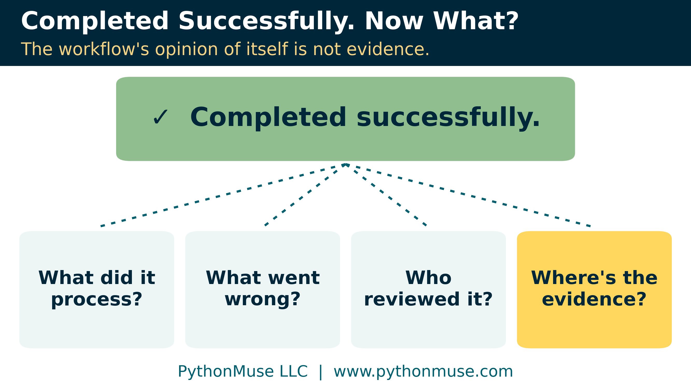
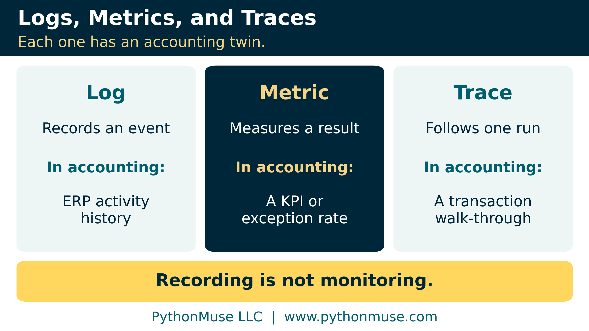
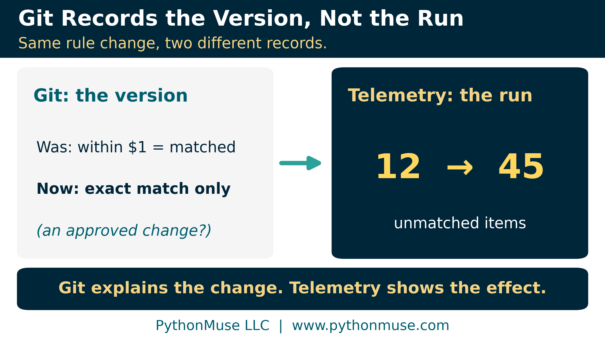
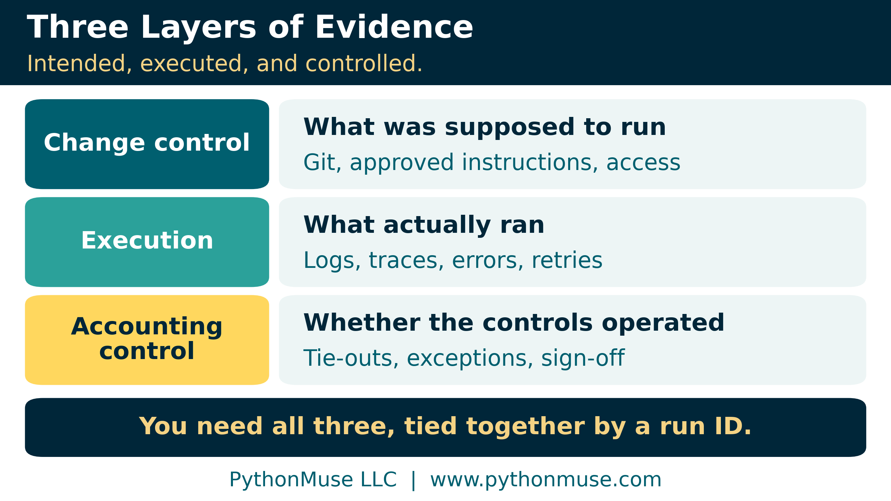
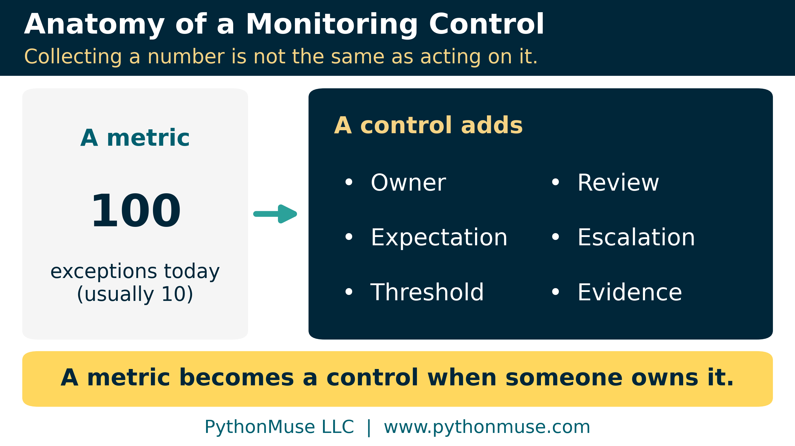
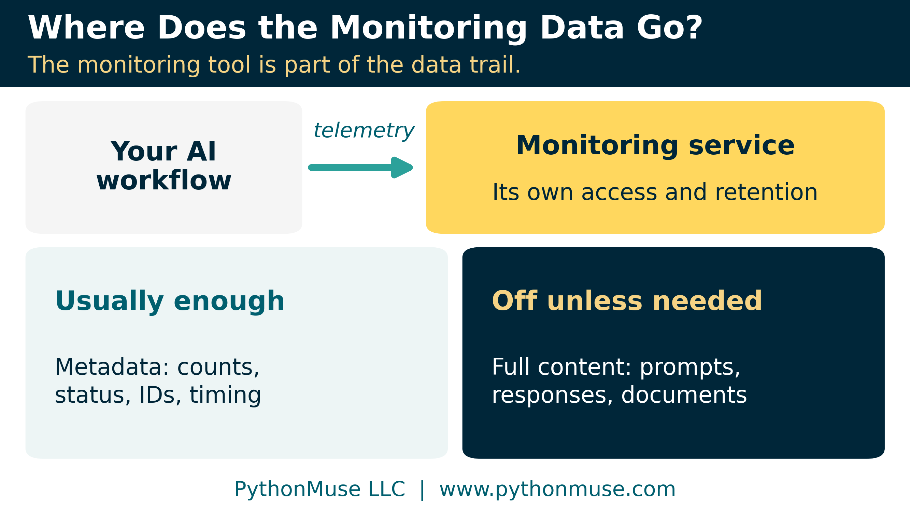

# Your AI Workflow Is Running. Who Is Watching It?

*Logs, telemetry, and monitoring controls for AI workflows, explained for accounting and finance professionals*

---

**PythonMuse LLC**
*Published November 2026*

<p align="center"></p>

---

Imagine your team has built an AI-assisted bank reconciliation. It imports the bank activity, compares it with the general ledger, flags what doesn't match, and prepares the reconciliation for review. It finishes, and a message appears: **"Completed successfully."**

Lovely. But what does it mean? Did it process every transaction? Did it use the right matching rule? Did it hit an error and quietly retry? And if your auditor asked what happened when it ran last Tuesday, what would you hand them? "Completed successfully" is the workflow's opinion of itself.

This Lab is about getting from that opinion to evidence. By the end, you'll be able to explain logs, metrics, and traces in accounting terms, say why Git records the version but not the run, sort a workflow's evidence into three layers, and turn a pile of telemetry into an actual monitoring control. The takeaway: **a successful run is a claim, not evidence. Monitoring is how someone checks the claim.**

> **This is a PythonMuse Lab.** Understand → Implement → Experiment. This article is the *Understand* layer and stands on its own. If you want to build it, [the technical appendix](./technical-appendix.md) is the *Implement* layer: a fictional bank reconciliation that writes its own activity log, run metrics, and an OpenTelemetry trace, plus five experiments to try. There's no separate companion demo this time; the code is small enough to run straight from the appendix.

> **Three words, used carefully in this article.** A **use case** is the job you want done: "reconcile the operating bank account each month" (see [AI Use Cases and How to Structure Them](../10-ai-use-cases-and-structure/README.md)). A **workflow** is the repeatable process built to do that job: the defined steps, rules, and instructions, which can be versioned like any other procedure (see [From One-Time Analysis to Repeatable Workflows](../11-one-time-to-repeatable-workflows/README.md)). A **run** is one execution of that workflow: Tuesday's reconciliation, with Tuesday's files, producing Tuesday's results. In accounting terms: the use case is the objective, the workflow is the written procedure, and the run is this month's completed reconciliation. Approving a workflow once does not tell you how any individual run went, and that gap is what this article is about.

> **New to Git?** We mention it early because it's half of the story. Git is the version-control tool that keeps a dated history of every change to your files, a bit like tracked changes for scripts and instructions. You don't need it to follow this article; a short explanation arrives later, and [Git Explained Using Accounting Terms](../20b-git-in-accounting-terms/README.md) is the friendly primer if you want it first.

---

## We Already Know How to Monitor Accounting Processes

None of these questions is new to accountants. When an invoice enters the payables system, we expect to know when it arrived, who approved it, whether the three-way match ran, and whether it was paid. We also watch the process as a whole: how many invoices went through, how many needed manual work, whether exceptions are creeping up.

Now give part of that process to an AI agent, meaning an AI system that can take steps on its own, such as reading files and calling other tools. It reads the invoice, fetches the purchase order, compares them, and calls another application to prepare the transaction. All of this takes seconds, and the person reviewing the result may never see the steps in between. A completed task doesn't mean the right process was followed. We need visibility into what happened between the request and the result. The technology industry calls this *observability*. Accountants would call it "being able to explain what happened."

---

## Logs, Metrics, and Traces, in Accounting Terms

Three technical words come up in any conversation about monitoring AI, and each has an accounting twin.

A **log** records an event: the workflow started at 9:00, imported 500 transactions, hit an error, retried, and finished at 9:03. Think of the activity history in your ERP.

A **metric** measures something: 500 transactions processed, 18 exceptions, three retries. Divide the exceptions by the transactions and you get an exception rate, 18 out of 500, or 3.6%. One run's rate is just a number. A hundred runs' rates are a trend, and a trend is something you can set an expectation for. If the rate usually sits around 3% and jumps to 9% after someone changes a matching rule, that's the moment to look. It's the same way we already use KPIs and exception rates.

A **trace** connects the steps inside one run, in order, with how long each took. It's the transaction walk-through, from source document to final conclusion. Here's what one made-up morning's bank reconciliation might look like as a trace:

```text
Run 7f3a: bank reconciliation                      total 3m 04s
  1. Load bank file (500 transactions)             2 s
  2. Load general ledger activity                  3 s
  3. Call matching tool                            41 s   <- first attempt failed, retried
  4. AI drafts explanations for 18 exceptions      2m 10s
  5. Prepare review package                        8 s
```

This run would end with "Completed successfully." Only the trace shows that step 3 stumbled and step 4 took most of the time. If tomorrow's run takes 20 minutes, you know where to start looking. The same trace can also show *which* steps happened at all. If step 2 is missing, the reconciliation ran without the ledger, and that deserves a phone call.

*Telemetry* is the umbrella term for all of it: the information a system sends out about how it's operating.

<p align="center"></p>

One point matters more than the vocabulary. **Recording activity isn't the same as monitoring it.** Monitoring begins when someone defines what should happen, decides what counts as an exception, looks at the evidence, and acts on what they find. A log nobody reads is a diary.

> **Go deeper: a bank reconciliation that leaves evidence behind.** A short Python example that writes an activity log, a metrics file, and a `workflow_failed` record, with the real output, is in [the technical appendix](./technical-appendix.md#3-build-a-bank-reconciliation-with-activity-logging).

---

## "But Doesn't Git Already Give Us an Audit Trail?"

If you build workflows in Visual Studio Code, you may already use Git, the version-control tool that records every change to your files. Git is great. It answers a different question: what changed in the files, such as a matching rule, the agent's instructions, or the Python script. It doesn't tell you what happened when the workflow ran.

> **Not using Visual Studio Code?** The idea doesn't depend on it. Our own examples use the Claude extension inside Visual Studio Code, but that's one setup among many. Other AI co-pilots offer the same kind of help in Visual Studio Code: the OpenAI Codex extension, GitHub Copilot's agents (often the natural route in Microsoft-standardized organizations), and Gemini Code Assist's agent mode from Google. Several of these tools, Claude Code included, can also run directly from a terminal with no code editor at all, and you can use a different editor entirely. Git works the same way in every case. PythonMuse teaches a framework you can apply anywhere. Product names and features change quickly, so check your own tool's documentation.

Say someone changes the bank reconciliation rule from "amounts within one dollar count as matched" to "exact match only." Git records that change neatly. Then the next run produces 45 unmatched items instead of the usual 12. Git won't notice. You need execution records to spot the jump, and then the Git history to explain it.

<p align="center"></p>

The best evidence connects the two: each run's record names the approved code version, model settings, and instructions it used. Even then, neither one proves the change was authorized or that the results are correct. That takes controls. [Git Explained Using Accounting Terms](../20b-git-in-accounting-terms/README.md) and [Pull Requests Are Internal Controls](../20e-pull-requests-are-controls/README.md) cover the change-control half.

---

## AI Platforms Are Starting to Show Their Work

Until recently, teams building AI workflows had to build most of their monitoring themselves. That's changing. In October 2026, Anthropic announced that the Claude Platform can export traces in OpenTelemetry format, in public beta. OpenTelemetry is an open-source standard for collecting and sending this kind of operational information, so that most monitoring tools can read it. The export covers Claude Managed Agents (Anthropic's hosted service for running agents), the Messages API (the interface software uses to talk to Claude models), and Anthropic's software development kits. Each agent turn, model call, and tool use shows up as a trace, with timing, token counts, and identifiers.

One example in the announcement comes from FloQast, which makes accounting workflow automation software for the close and reconciliations. FloQast described seeing each model call in the same trace as the reconciliation or journal-entry workflow it ran inside, with the prompt version, tool calls, timing, and token spend together. Its summary is one any controller could have written: *"Agents that touch a company's books have to show their work, the same way an accountant does."*

That's encouraging. It's also worth being precise about what it shows. A trace can show that an agent called the reconciliation tool and got a successful response. It can't show that the reconciliation was right: the population might have been incomplete, the matching rule wrong, or the journal entry prepared without the required approval. Anthropic's own documentation is admirably candid on a related point: exported traces are delivered on a best-effort basis and aren't guaranteed to be a complete record.

Technical observability tells you how the process executed. Accounting controls tell you whether it met its requirements. You need both.

> **Go deeper: native AI observability.** What the Claude Platform traces capture, how Claude Code's own telemetry works, and a safe way to try it locally with fictional data are in [the technical appendix](./technical-appendix.md#6-what-happens-when-an-ai-agent-is-involved).

> **Other platforms offer this too.** Claude is our example, but tracing isn't unique to it. OpenAI's Agents SDK records traces of model calls, tool calls, and handoffs by default. Microsoft Foundry stores agent traces in Azure Monitor Application Insights, and Copilot Studio agents can send their telemetry there too. Google's Gemini Enterprise Agent Platform, the successor to Vertex AI, can export agent traces to Cloud Trace. Whichever platform records the run, a person still decides what counts as an exception and reviews it. Features and names change quickly, so check your own platform's documentation.

---

## What Should Accountants Actually Monitor?

Not everything a platform can record. Start with the accounting risks of the workflow, not the menu of available telemetry.

For a bank reconciliation, the risks are completeness, matching accuracy, the treatment of exceptions, authorized changes, and evidence of review. So a useful run record says how many transactions came in, how many were matched, how many are still open, and whether the validation checks passed. If AI is involved, add which model and instructions were used, which tools were called, and what failed or was retried. For journal-entry preparation, the focus shifts to the source data, the proposed entries, the approval status, and, importantly, whether anything was actually posted.

Monitoring should be proportional to the risk and to how much you rely on the output. An AI co-pilot polishing an internal email doesn't need the same monitoring as an agent preparing entries for the general ledger. Nobody needs a dashboard for "made the tone friendlier."

And you don't need an enterprise platform to start. For a small workflow, a few lines of Python can write an activity log and a metrics file that opens in Excel. Start by deciding what evidence the workflow must produce if something goes wrong. An AI co-pilot can help you build the logging; it can't decide which exceptions matter to your close.

---

## Three Layers of Evidence

I find it useful to sort AI workflow evidence into three layers.

**Change-control evidence** is what was supposed to run: version history, approved instructions, model settings, access permissions, and documented changes. Git covers part of it; approvals and deployment controls cover the rest.

**Execution evidence** is what actually ran: logs, traces, tool calls, errors, retries, and timings. Native AI telemetry and the workflow's own logging collect it.

**Accounting control evidence** is whether the required controls operated: completeness checks, reconciled amounts, resolved exceptions, approvals, and proof that an authorized person reviewed the result.

<p align="center"></p>

Take a workflow that produces a journal-entry file. Git identifies the script version. Telemetry confirms it ran without a technical error. The accounting review still has to establish that the amounts are right, the accounts are appropriate, the entry is supported, and approval happened before posting. That last step can't be replaced by a success message, however green. It's the layer [From AI Answers to Audit Trails](../32-from-ai-answers-to-audit-trails/README.md) is about.

---

## Collecting Data Is Not a Control

Once the telemetry starts flowing, it's tempting to build dashboards of everything. None of them makes a control effective by itself.

Suppose a reconciliation usually produces ten exceptions a day, and today it produces 100. If nobody looks at the trend, the metric has done roughly as much as a smoke detector with no battery. Or suppose the workflow stops running altogether. If your only evidence is the record written at the end of a successful run, the missing run leaves no record at all. Nobody gets an alert from a job that never started. Someone has to check that the runs you expected actually happened.

A monitoring control needs the same parts as any other control: an owner, a defined expectation, a threshold for what counts as an exception, a review frequency, an escalation path, and evidence that the review happened.

<p align="center"></p>

And then there's the question auditors enjoy most: who monitors the monitoring? If someone disables logging, raises the exception threshold, or quietly changes where the telemetry is sent, how would you know? These are familiar internal control questions, applied to a new technology.

> **Go deeper: designing a monitoring control.** An example control for a daily bank reconciliation, and the questions to ask about whether the logs themselves can be trusted, are in [the technical appendix](./technical-appendix.md#7-design-an-accounting-monitoring-control).

---

## Where Does the Monitoring Data Go?

More logging isn't always better. AI workflows handle customer financial information, payroll, and contracts, and some observability tools can capture entire prompts and responses. An organization can carefully restrict where financial information is processed, then discover that detailed telemetry is being exported to a third-party service with its own access rules and retention. The monitoring environment is part of the workflow's data handling, and it goes through the same data classification and vendor review. [How to Use AI in Accounting Without Sending the Wrong Data](../06-safe-ai-data-workflows/README.md) applies to telemetry too.

<p align="center"></p>

Read the defaults before you switch anything on, because they differ. Anthropic's Claude Platform tracing records metadata only unless you opt in to full content, and Claude Code doesn't log prompt text unless you enable it. OpenAI's Agents SDK, by contrast, includes inputs and outputs in its traces unless you turn that off. For many accounting workflows, operational metadata is enough: you can record that a transaction was processed, an exception was raised, or a tool was called without copying the bank statement into the log. The goal is useful evidence, not unlimited data.

> **Go deeper: what to capture and what to leave out.** The content settings for each tool, and a short checklist before you enable detailed logging, are in [the technical appendix](./technical-appendix.md#8-be-careful-what-you-capture).

---

## Before Your Next AI Workflow Goes Into Production

A workflow can be designed, tested, and approved, as [You Built an AI Workflow. What Happens If You Win the Lottery?](../40-builder-to-production/README.md) describes. Approval is the starting point, not a promise about every future run. Inputs change, systems fail, and [models get updated](../36-model-selection-is-a-control/README.md). Monitoring is how you notice the drift. You don't need to become an observability engineer, but before you approve an AI-assisted process, check that you can answer four questions. Can you identify the approved version? Can you tell what it processed and what it did? Would you notice a missing run, an error, or an unresolved exception? Can you show that someone reviewed the results and approved the actions? Then the fifth, quieter one: can you trust the evidence itself?

**Try it Monday.** Pick one automated workflow your team relies on, AI or not. Find its most recent "completed successfully" and try to answer the four questions using only what the workflow left behind. If you can't, you've found the first thing to log. And if you want to see the mechanics, run the experiments in [the technical appendix](./technical-appendix.md#9-suggested-experiments); the one where the workflow crashes halfway is the most instructive five minutes in the Lab. I'd love to hear what your team's workflows turn out to be recording, and what they aren't.

---

## Why This Matters for What's Coming Next

There's another reason to get comfortable with these ideas now. A new generation of AI-native ERP systems, and what some are calling an "AI operating system" for the business, aim to put agents much closer to the ledger itself: not just suggesting the entry, but part of the system that records it.

When that happens, the questions in this article become the questions to ask of the platform: what ran, what changed, who reviewed it, and where does the evidence live? Understanding logs, metrics, and traces is how you'll be able to ask them well, and to tell a real answer from a reassuring one.

We're genuinely excited about this. In 2027, PythonMuse plans to research and test what AI-native ERPs and an AI operating system mean for accounting and finance teams, hands on, and then write up what we learn, including the parts that don't work yet. Consider this article your pre-reading.

**If AI is performing accounting work, we should be able to answer the same questions we ask of any other accounting process: What happened, what went wrong, who reviewed it, and where is the evidence?**

---

## Sources

Every product and tool statement in this article was checked against the provider's own documentation in November 2026. The full, dated list is in [the technical appendix](./technical-appendix.md#sources).

---

> **Author's note.** This article grew from *a question we left open while writing about data lineage: once you know where the data came from, how do you know what the AI workflow did with it while it ran?* and was written in collaboration with Patrick Toohey, with human and AI assistance. I reviewed the content, challenged the recommendations, and made the final editorial decisions.

---

*Related: [When to Trust AI to Run Your Accounting Workflows](../12-audit-ready-ai-workflows/README.md) | [Git Explained Using Accounting Terms](../20b-git-in-accounting-terms/README.md) | [Pull Requests Are Internal Controls](../20e-pull-requests-are-controls/README.md) | [How to Use AI in Accounting Without Sending the Wrong Data](../06-safe-ai-data-workflows/README.md) | [From AI Answers to Audit Trails](../32-from-ai-answers-to-audit-trails/README.md) | [Model Selection Is an Accounting Control](../36-model-selection-is-a-control/README.md) | [You Built an AI Workflow. What Happens If You Win the Lottery?](../40-builder-to-production/README.md) | [AI Helped Me Build It. AI Does Not Have to Run It.](../42-ai-helped-me-build-it/README.md) | [I Built the Workflow. Now How Does My Team Use It?](../46-team-ready-workflows/README.md) | [Technical Appendix](./technical-appendix.md)*

*© 2026 PythonMuse LLC. Content licensed under [CC BY-NC-SA 4.0](../../LICENSE); code licensed under [MIT](../../LICENSE-CODE).*
